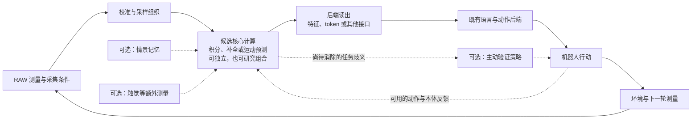

# OWAC：面向物理智能的 RAW 原生感知与可修正推断

*RAW-Native Perception and Revisable Inference for Physical Intelligence*

**文档性质：学术研究方案**　｜　**版本：1.0**　｜　**日期：2026 年 10 月 9 日**　｜　**目标会议：RSS 2027**

## 摘要

机器人在弱光、高动态范围和运动条件下的感知困难，既来自传感器获得的有效信息不足，也来自信号处理与表征压缩对任务相关证据的损失。现有视觉语言动作模型通常接收经过图像信号处理器转换的 RGB 图像；近期研究已将可学习的图像信号处理用于机器人操作，但其主要接口仍是面向原视觉编码器的图像。OWAC 拟研究一种不同的计算路径：直接从原始传感器测量形成可供语言与动作模块使用的表征，并将弱证据的积累、结构解释的形成及错误解释的修正纳入编码过程。项目借鉴生物弱光视觉、循环补全和感觉运动交互，重点探索自适应时空证据积分、测量约束的循环补全，以及自运动预测与外部变化分离三个核心方向；情景记忆作为支持机制，跨感官约束和行动验证作为可选系统扩展。研究允许神经网络、解析计算、显式推断及混合实现，并保留多种架构家族。我们将通过受控成像与物理干预、错误先验修订、跨传感器测试和机器人闭环实验，区分输入信息、计算机制与系统适配各自的贡献。本方案提出研究问题、设计边界和验证协议，不报告尚未获得的算法或实机结果。

**关键词：** RAW 感知；物理智能；生物启发计算；弱光视觉；可修正推断；视觉语言动作模型

## 1. 引言

考虑一个机械臂在昏暗环境中将物体放入狭窄槽口的任务。图像中绝大多数区域可能与动作无关，而槽口边缘的一小段弱信号却决定物体能否进入。为了得到视觉上平滑、明亮的图像，处理过程可能抑制这段信号；反过来，增强过程也可能产生并不存在的边缘。对机器人而言，重要的是边缘是否有测量支持、位置是否足够准确，以及获得这一判断是否耗费了过长时间。图像是否清晰，只是其中一个间接因素。

这一问题在运动中进一步复杂化。相机随机械臂或轮式机器人移动，相邻帧中的变化既可能来自自身运动，也可能来自物体运动、照明变化或噪声。如果机器人只把每帧压缩为一个确定的视觉描述，早期错误可能在后续动作中被不断放大。如果它能够保留尚未确定的解释，在新证据到达后局部修正，就有机会在相同观测条件下做出更可靠的物理决策。

OWAC 因而把研究对象定义为：**在弱证据条件下，形成、维持和修正服务于物理行动的表征的计算框架。** RAW 编码是该框架的第一个完整应用实例。项目将替换现有视觉语言模型（VLM）或视觉语言动作模型（VLA）的 RGB 视觉编码器，继承其语言与动作能力，直接输出特征、关系、状态或其他可读出的表示。主编码链路不生成 RGB、sRGB 或 XYZ 中间图像，也不以 RGB 重建或 RGB 教师蒸馏作为训练目标。

选择 RAW 并不意味着更高位深必然带来更好的控制。位深描述数字量化精度，有效动态范围还取决于传感器饱和、读出噪声、光子数量和曝光条件；RGB 也可以采用浮点表示。RAW 的研究价值在于能够在较少显示处理干预的条件下保留原始采样，并把采样位置、曝光、噪声及饱和等测量条件显式纳入计算。它能否优于充分调优的图像输入，必须由实验回答。

项目从设计之初以具有 ResNet、Transformer 那样广泛复用潜力的计算框架为长期目标。这一目标意味着需要提出清楚的计算对象、交互规则、组合方式和扩展路径；历史影响力本身不能作为短期实验指标。RSS 2027 阶段应形成一个边界明确、可以复现和反驳的阶段成果：新规则如何作用于原始测量，如何改变机器人决策，以及这种改变在完整系统成本下是否成立。

## 2. 相关工作与研究定位

### 2.1 从 RAW 视觉适配到机器人感知

Ziteng Cui 及其合作者的研究为本项目提供了直接的技术参照。RAW-Adapter 将输入端可学习处理与预训练视觉模型适配结合起来，说明相机测量与既有视觉表征之间的域差异需要显式处理。Dr. RAW 进一步研究传感器及任务条件化的高层 RAW 视觉。这些工作表明，直接使用 RAW 和适配预训练模型都已有基础，不能单独作为 OWAC 的新贡献。[1][2]

跨传感器研究则提醒我们，RAW 不是相机无关的统一格式。RAWild 使用物理启发的曲线及局部变换研究跨传感器检测；MERIT 研究多域 RAW 到 RAW 的转译与噪声建模。OWAC 可以吸收其成像建模、传感器条件记录和数据拆分经验，但要保留各工作实际方法的区别：RAW 到 RAW 的转译不等于 RGB 重建，也不等于非神经计算。[3][4]

最直接的机器人参照是 RawVLA。该工作已经通过面向动作目标的流式神经 ISP，为 VLA 生成适应任务的视觉输入，并开展机器人操作评估。因此，“RAW 改善暗光操作”“用动作损失训练感知”和“引入时间状态”均不足以单独界定 OWAC 的创新。OWAC 的明确路径差异，是以原始 CFA 测量直接形成非图像表征并替换原视觉塔；研究贡献还需要进一步落实到具体的计算规则及其闭环作用。[5]

M³A Policy 通过光度重渲染改变机器人示范中的材质外观，提供了保持动作语义、改变视觉条件的数据设计经验。这里需要区分光学外观与动力学：改变表面颜色或反射外观，有时可以保留原动作；改变摩擦、质量或柔顺性则可能需要新的动作标签。OWAC 将分别设计成像干预和物理干预，避免把视觉鲁棒性误写成对物理变化的适应能力。[6]

### 2.2 生物弱光视觉与信息补全

生物视觉为弱信号处理提供了两类互补启发。第一类涉及对有限测量的选择和积累。杆细胞到双极细胞的非线性传递能够通过舍弃部分响应抑制噪声；天蛾视觉系统中的空间与时间求和能够提高暗光灵敏度，同时涉及空间细节与响应速度的取舍。天蛾跟踪运动花朵的研究进一步说明，感知延迟需要放在任务的运动频率中理解。[7][8][9]

第二类涉及利用已有结构解释不完整输入。视觉图案补全研究支持循环计算的作用；预期刺激缺失时，初级视觉皮层仍可能出现与预期特征相关的活动；海马研究则表明，部分线索可以参与经验记忆的恢复。[10][11][12] 这些现象启发我们研究内部假设的提出、维持与修订，但不能直接证明极低照度下可以恢复任意几何。遮挡补全、低光子测量和空间记忆是不同实验问题，应分别检验。

感觉运动与跨感官研究补充了另一层约束。小鼠视觉皮层对预期和实际视觉反馈差异的响应，提示自运动信息可以参与视觉更新；视觉与触觉判断、视觉搜索中的眼动研究，则提示证据可靠性和主动采样与行为有关。[13][14][15] OWAC 将这些观察转化为工程问题，而不声称复制完整的视网膜、皮层或海马机制。

### 2.3 从生物启发到可检验的计算贡献

预测编码、递归估计、联想记忆、信念修订和主动感知已有丰富的计算方法。预测编码模型研究内部预测与残差之间的关系；可微粒子滤波将算法先验与学习结合；现代 Hopfield 网络建立了联想更新与注意力的联系；真值维护系统研究推断依据及其撤回；主动感知已有将观测选择写成序贯决策的方法。[16][17][18][19][20]

因此，新颖性判断应落实到更新、组合或执行规则。一个候选需要说明其与最近方法的关系：哪些结构继承自已有方法，哪一条规则是新增设计，以及在什么条件下二者产生可观察的差异。若差异完全来自更多历史帧、额外模态、更大的后端或更长计算时间，结果仍可能有工程价值，但不能据此确认新的感知计算机制。

## 3. 问题定义与研究假设

### 3.1 将 RAW 视为带条件的测量

本文首先面向采用彩色滤光阵列（color filter array，CFA）的相机。以常见 Bayer 阵列为例，每个采样位置只直接测得一个滤色通道的响应，并没有一组完整的 RGB 值。因此，采样位置和滤色排列是测量含义的一部分，不能仅把 RAW 当作位深更高的三通道图像。

设时刻 $t$ 的原始观测为 $y_t$，场景状态为 $x_t$，测量条件为 $m_t$。$m_t$ 包括 CFA 排列、采样坐标、曝光、增益、黑白电平、时间戳和可获得的传感器标定。一个用于组织问题的简化表达为：

$$
y_t = Q_b\!\left(\operatorname{sat}\!\left(\mathcal{A}_{m_t}(x_t)+\varepsilon_t\right)\right).
$$

其中，$\mathcal{A}_{m_t}$ 表示由场景到传感器读数的测量过程，$\varepsilon_t$ 表示可能依赖信号强度的噪声，$\operatorname{sat}$ 表示饱和，$Q_b$ 表示 $b$ 位量化。这是概念性记号，不是已标定的相机模型；真实模型还需依据传感器区分噪声来源、读出过程及时间效应。

在这一表述下，缺失、坏点、饱和和低信噪比测量具有不同含义。黑电平校正、坏点掩码、CFA 重排与噪声估计可以帮助解释测量，但不能把不可观测细节变为已知事实。编码器需要在有限信息下保留对行动有用的内容，并在必要时保留歧义。

### 3.2 编码器与动作后端

用 $h_t$ 表示编码器在时刻 $t$ 的内部表示或持续状态，$c_t$ 表示允许使用的上下文，例如已经执行的动作、本体状态和语言目标。整体接口可写成：

$$
h_t = \mathcal{U}(h_{t-1},y_t,m_t,c_t;B_t),
\qquad z_t = \mathcal{R}(h_t),
\qquad a_t \sim \pi(\cdot\mid z_t,g_t,s_t).
$$

$\mathcal{U}$ 是待研究的计算过程，$B_t$ 表示计算或反应时间预算，$\mathcal{R}$ 将内部表示读出为后端可使用的 $z_t$；$g_t$ 与 $s_t$ 分别表示任务目标和本体状态。确定性动作后端可用函数形式代替上述条件分布。无状态候选可以忽略 $h_{t-1}$，不依赖任务的编码器也可以不使用相应上下文。

这些符号只规定系统关系，不规定内部架构。$h_t$ 可以是向量、连续场、图、解析系数、动态实体或一组假设；$\mathcal{U}$ 可以是神经网络、显式求解器或二者结合。即使后端需要 token，也只要求读出层提供该接口，不要求核心计算采用 Transformer。上述通用表达本身不构成算法创新。

### 3.3 三项核心假设

**假设一：积分范围与反应期限的共同组织能够改善弱测量下的感知—控制取舍。** 在相同因果观测流和曝光条件下，依据测量可靠性、运动及任务精度分配时空积分，可能比固定积分或通用时序编码更好地兼顾弱信号利用、空间定位和反应延迟。

**假设二：可被反证修订的结构解释能够改善不完整观测下的行动。** 当测量无法支持唯一解释时，保留并逐步修订与动作相关的可能结构，可能比过早形成单一确定表征更可靠。其关键检验不只是先验正确时的收益，还包括先验错误时是否能够及时改正。

**假设三：将自运动预测纳入原始测量更新，有助于保留对外部变化的敏感性。** 在相同动作及本体上下文下，面向采样几何和测量误差组织状态传播，可能更好地区分自身运动、物体运动和成像变化，从而改善持续定位与动作修正。

三项假设可以分别成立或失败，也可以由不同架构实现。研究不预先假定它们必须组合才能有效。情景记忆、触觉或主动观测可以扩展其中的问题，但不作为检验三个核心假设的统一前置条件。

## 4. 总体框架：从测量到可行动表征

OWAC 将系统分为测量入口、核心计算、后端读出和行动四个职责层面。测量入口保留原始 CFA 数值及采集条件；核心计算形成任务可用的表示；读出层解决这种表示与既有语言或动作模块之间的接口问题；行动改变环境，并产生下一轮可用观测。

*图 1. OWAC 的系统关系。实线表示基本感知—行动链路，虚线表示可选信息或扩展。核心框内列出的是候选研究方向，并非三个必须串联的模块。主链路不包含 RAW 到 RGB 的图像生成步骤。*

框架设计的首要约束，是使表示形成过程与测量含义保持联系。例如，循环补全产生的槽口位置，可以用于提出下一步动作假设，但不能被当作相机又测得了一次槽口。重复处理同一帧可以改善求解，却不能重复计入独立证据。类似地，记忆中的物体结构只有在当前条件仍成立时才有帮助；与新观测矛盾时，应允许撤回相关解释。

这种区分首先是可观察的行为要求，不强制所有候选都设置“测量分支”“先验分支”或显式概率字段。解析方法可以维护依赖关系，神经方法可以通过状态组织、学习目标和受控测试建立对应行为。若方法输出概率，需要检验校准；若输出假设集合，需要检验覆盖和排除错误解释的能力；不能把任意特征幅度直接解释为置信度。

框架的第二项约束是可组合与可扩展。一个候选不能只给出孤立的 RAW 前置变换，还需要说明局部到全局的信息如何形成、状态如何跨时间维护、多个单元怎样组合，以及模型规模和计算预算如何增加。迁移到其他信号时，应能区分输入适配器与保持不变的核心规则。附录 A 保留十二个架构家族，以维持这些设计问题的多样性。

## 5. 三个 RAW 核心研究方向

### 5.1 自适应时空证据积分

弱光下单次测量通常不足以支持精细判断。扩大空间范围或积累更多时刻的观测可以增加可利用信号，但也可能混合不同物体、模糊细边缘或引入控制滞后。这个方向的核心计算对象是**测量支持域**：哪些位置、哪些时刻的测量，可以在什么条件下共同支持同一个局部结构。

拟研究的规则包括支持域的合并与分裂、运动条件下的对应关系、积分状态的保留与遗忘，以及在反应期限到达时如何读出。举例而言，同一片缓慢变化的平坦区域可以较长时间积累，而快速移动的细小边缘需要更短的积分时间和更精确的空间对应。任务对定位精度和时延的要求可以参与调度，但调度所使用的信息必须在当前时刻可得。

神经实现可以研究具有可变时间常数、局部交换及条件化读出的状态场；非神经实现可以从噪声统计、顺序估计及显式支持域选择出发。二者的输出都可以是结构响应、局部状态或解析系数，而无须形成一幅“更亮”的图像。真正需要提出的新设计，是这些更新如何成为可组合的规则，而非仅增加一个时序池化模块。

首个机制实验可交叉改变弱边缘强度、目标运动速度和定位容差。在相同原始观测流下，对比固定积分、自适应滤波、运动补偿积分和普通循环编码，观察弱信号利用是否以必要的定位能力或时延为代价。随后把同样的取舍放入机械臂放置任务。如果收益仅来自多看几帧、延长曝光或放宽任务精度，就不能支持所提出的机制解释。

### 5.2 测量约束的循环补全

局部测量不足时，空间结构和经验可以帮助提出解释。例如，暗处一段弧形轮廓可能属于杯口，也可能属于杯柄；两种解释对应不同抓取位置。此方向研究**可竞争、可组合、可被否定的潜在结构解释**，使上下文帮助形成假设，并让原始测量限制这些假设。

拟探索的重点是反证到达后的修订规则。一个局部解释可能已经参与多个关系或动作判断；当新测量否定它时，系统需要决定哪些关联状态必须更新、哪些仍可保留，以及有限计算应优先用于何处。这种局部修订可能由循环神经状态、能量或约束求解、粒子假设、动态实体组合等方式实现。贝叶斯估计、预测编码和多假设跟踪提供起点，但采用这些名称本身不构成新方法。

“补全”的对象是供行动使用的潜在几何、关系或候选状态。例如，系统可以维持两个把手方向的解释，并在获得新线索后排除一个；无需把不可见部分渲染成像素。若为了检验假设而预测 RAW 测量，预测值应作为与真实观测比较的对象，不能被再次当作真实观测送回累积过程。

核心实验应主动安排正确、错误和无信息先验，并控制后续证据的强度与到达时刻。比较单假设回归、普通循环编码、粒子或可微滤波，以及同预算的多假设方法。除任务成功率外，记录错误补全造成的动作偏差、反证后的纠正时间和仍未消除的歧义。如果模型只在先验正确时受益，遇到相反测量仍坚持原解释，就不足以支持“可修正推断”的主张。

### 5.3 自运动预测与外部变化分离

机器人相机的运动使 RAW 序列天然与身体状态相关。一个固定物体在不同帧中落在不同像素和 CFA 采样位置；曝光、遮挡和物体自身运动还会改变其测量。此方向研究**状态随自运动传播、在新测量中建立对应并修正预测的规则**。

拟探索的计算需要把实际执行的动作、本体状态和标定信息用于预测可解释的观测变化，再依据真实测量更新未被解释的部分。预测不必生成完整图像，可以作用于空间关系、局部结构或连续状态。实现可以是学习的状态传播，也可以是显式几何与估计过程；关键是说明测量坐标、时间和运动误差如何影响更新。

这一方向与普通视频编码的差异不能只靠增加动作输入来证明。直接基线也应获得相同的动作、本体信息和观测历史，并包括合适的运动补偿、递归估计或状态模型。需要进一步比较不同传播与修正规则，分析它们如何处理标定偏差、预测失配和外部真实运动。

实验分别设置“相机动、物体不动”“相机不动、物体动”“二者都动”以及“只有照明变化”等条件，再考察目标持续定位与闭环动作。期望的性质是正确解释自身运动，同时保留对目标位移或障碍变化的敏感性。如果表示对所有变化都不敏感，任务平均分可能暂时稳定，却不能说明形成了适用于物理行动的状态。

## 6. 记忆支持与可选具身扩展

### 6.1 情景记忆引导的补全

情景记忆适合支持当前测量不足的情况。机器人刚刚看见某物体的开口方向，随后因遮挡或弱光只能看到少量线索，近期经验可以帮助恢复相关结构。需要研究的是经验的有效条件、读取与写入规则，以及陈旧记忆怎样被新测量修订，而不只是增加一个缓存或检索库。

在当前方案中，记忆首先作为编码核心的支持机制保留；如果其写入、组合和撤回规则形成独立计算框架，也可发展为完整候选。实验应在相同历史、存储和读取成本下对比普通缓存、循环状态和联想记忆，并安排物体被替换、移动或改变结构的情况。记忆提高连续识别能力的同时，应允许机器人承认“现在与刚才不同”。

### 6.2 跨感官物理约束

触觉、接触力或其他传感器能够约束视觉中的歧义，例如区分空隙与实际接触，或修正被弱光干扰的表面位置。但额外模态带来了新的信息来源，收益不能直接归因于 RAW 编码。因此，跨感官约束被列为可选系统分支，其研究问题是不同时间、坐标和可靠性的证据如何共同约束状态，以及冲突证据如何被处理。

对照方法应获得相同模态与接触机会，并包括简单拼接、门控融合及合适的显式估计方法。只有在控制额外信息后，新约束或修订规则仍改善物理判断，才能支持该方向的计算贡献。对于当前视觉不可观测的摩擦等属性，应明确其证据来自何种交互，而不要求单帧 RAW 凭空推断。

### 6.3 通过行动验证假设

当两种解释会导致不同动作时，机器人可以改变视角、等待新的观测，或执行低成本探测。这个方向研究观测选择如何针对任务相关分歧，而非一律追求视觉信息量最大。例如，两种杯柄解释若影响抓取方向，就值得验证；对当前动作无影响的纹理歧义则可能不值得额外移动。

主动验证可以先在已有的简化状态估计器上研究，不必等待新 RAW 主干完成。后续集成时，要比较固定观测、启发式重观测和已有主动感知策略，并统一动作空间及可用信息。曝光等待、相机移动、接触动作、控制风险和计算均进入成本记录。该方向适配 RAW 系统，但其本身并不是一个完整的 RAW 编码器。

六个方向在当前方案中的关系如下。

| 方向 | 在系统中的位置 | 与 RAW 的直接联系 |
| --- | --- | --- |
| 自适应时空证据积分（N01） | 核心编码候选 | 依据采样、噪声、时间和运动组织测量 |
| 测量约束的循环补全（N02） | 核心编码候选 | 用原始测量约束、检验和修订潜在解释 |
| 情景记忆引导的补全（N03） | 支持机制，也可发展成独立框架 | 以当前测量验证经验的适用性 |
| 自运动预测与变化分离（N04） | 核心编码候选 | 在采样几何和运动关系下更新表征 |
| 跨感官物理约束（N05） | 可选多模态扩展 | 为 RAW 中的歧义提供独立物理证据 |
| 通过行动验证假设（N06） | 可选感知—行动扩展 | 主动获得能区分任务相关解释的新测量 |

这一区分决定实验归因，不构成永久的资源排名。方向能够用于 RGB 或其他信号也不是缺点；框架的通用性正是长期目标。需要证明的是它在 RAW 测量条件下解决了什么问题，并且这种作用如何传递到物理行动。

## 7. 学习、求解与既有模型接入

### 7.1 从原始测量建立表征

训练方式随候选而定。神经候选可以结合动作监督、RAW 域预测和测量一致性学习；显式方法可以使用标定参数、固定变换或数据估计的统计量；混合方法则需要明确哪些规则解析确定、哪些参数通过数据学习。RAW 自监督任务必须考虑噪声相关性、缺失及饱和，否则模型可能学到固定传感器噪声，或在不可识别条件下只复现先验。

动作损失用于连接表征与任务，但不能替代对机制的检验。一个模型可能依赖场景捷径获得训练任务成功，而没有保留真正的测量依据。因此，应同时使用受控扰动、错误先验及结构变化实验，检查表示与行为是否随相关证据改变。具体损失形式和权重在候选机制确定后分别推导，不预先给所有框架套用同一目标函数。

严格非神经版本需要单独界定。若编码器由固定解析变换或显式求解组成，其核心不应隐含可训练的卷积、MLP 或学习投影；若使用数据拟合的字典或统计模型，则应说明它属于何种学习。后端可以仍是神经网络，但这不等于整个系统非神经。读出中任何可训练部分都要单独记录其容量与作用。

### 7.2 替换视觉塔并恢复语义接口

首个工程后端采用已部署的 π0.5 PyTorch 路径，以官方 openpi 实现为基础。[21] 研究阶段将移除原 RGB 视觉塔，通过独立的 RAW 入口和读出接口接入新编码器。继承语言与动作模块的预训练能力，是本项目基于既有 VLM/VLA 开展研究的前提；继承这些参数不意味着继续使用原图像塔，也不等于进行 RGB 教师蒸馏。

新编码器输出的形状与原视觉特征一致，并不保证语义一致。适配过程需要覆盖语言条件、视觉读出和动作预测之间的联系。实验应分别报告冻结后端、有限参数适配和更充分适配的设置；具体训练容量依据资源与先导结果确定，但候选与直接基线必须使用可比协议。

如果内部表示保留多个解释，读出还需要证明没有把它们无条件平均成一个不存在的中间几何。可以研究多个候选表示、条件化读取或其他接口；采用何种方式由后端能力和实验决定。编码机制与读出效果应通过替换实验分开检查。

### 7.3 因果执行与完整成本

持续状态必须有明确的初始化、更新时间和重置规则。在线计算只能使用当前及过去可得信息；训练时使用的辅助标签应与部署输入分开。异步或增量候选还需要说明未更新区域如何保持有效，以及计算终止时如何提供可用输出。

系统成本从传感器读出开始计算，覆盖传输、校准、状态维护、核心计算、读出与动作后端。报告真实端到端延迟及其分布，而不仅是算子 FLOPs。循环或求解型方法应在匹配预算下比较，同时报告充分运行时的能力，区分机制局限和当前实现效率。

## 8. 实验设计与证据标准

### 8.1 数据与测量协议

实验平台包括机械臂和移动轮式人形机器人。首阶段优先在机械臂任务上建立可控、可重复的证据，随后研究移动条件下的迁移。相机尚未选型；选型目标是获得可验证的原始测量及元数据，而非只依据标称位深。实际有效信息、暗场噪声、饱和、时间同步和读出延迟均需测量。

采集保留无损原始数值，并记录 CFA、坐标、曝光、增益、黑白电平、时间戳、传感器与处理历史。校准及早期方差计算优先使用 FP32，转为较低精度前检查误差。不得在图像加载、缩放、归一化或视频编码中隐式转为 8-bit。重新马赛克的图像和逆处理 sRGB 可以作为单列的合成条件，但不能标注为真实传感器 RAW。

仿真用于控制几何、运动和成像变量，真实相机用于检验传感器差异与模型失配。两类证据分开报告。数据按物体、场景、采集会话、照明和传感器划分，防止相邻帧跨训练与测试集；留出相机的直接迁移结果与经过适配的结果也应分开。

### 8.2 三组主要任务

**弱边缘下的精确放置。** 选择视觉依赖明确、底层控制可靠的槽口放置或对齐任务，改变照度、局部对比、目标速度和定位容差。该任务检验证据积分能否改善实际放置，同时保持足够的空间精度和响应速度。若最终使用插入任务，需要先确认接触控制误差不会主导结果。

**运动中的持续定位与动作修正。** 让相机或目标发生可控运动，独立加入照明突变、短时饱和或遮挡，检验状态传播与测量修正。机械臂相机先建立受控条件，再迁移到轮式平台的接近、对齐或避障任务。移动平台增加的定位与控制因素应单独诊断。

**错误先验下的补全与纠正。** 使用局部外观相似但把手、开口或可抓取部位不同的物体，先提供歧义线索，再提供支持或反驳初始解释的新证据。安排记忆正确、陈旧、误导和缺失的条件，观察错误解释是否改变动作、何时被修正，以及模型在持续歧义下采取何种行为。

跨感官与主动验证分别扩展这些任务，不要求所有实验同时增加触觉和主动探测。每个候选先完成最能区分其机制与已有方法的实验，再进入共享闭环比较。

### 8.3 系统与机制基线

| 系统对照 | 用途 | 关键比较条件 |
| --- | --- | --- |
| 充分调优的 RGB VLA（C0） | 检查新系统相对成熟视觉路径的实际收益 | 同源观测、合理增强及充分后端适配 |
| 高精度线性图像或 XYZ 输入（C1） | 分离量化精度、显示处理与 RAW 结构的作用 | 浮点输入及相应视觉适配；属于独立图像基线 |
| RawVLA 或动作监督神经 ISP（C2） | 比较已有面向动作的成像处理 | 分报原论文配置与可比后端适配配置 |
| 普通 RAW CNN/ViT（C3） | 分离新计算规则与直接 RAW 接入的贡献 | 同样替换图像塔，匹配数据、读出和后端适配预算 |
| RAW patch 固定投影（C4） | 检查复杂编码是否必要 | 相同采样信息和可比后端接口 |

系统比较之外，每个候选还需要最近机制基线。积分方向比较滤波、运动补偿和时序网络；补全方向比较循环推断、粒子或其他适用的多假设估计；记忆方向比较缓存与联想读取；自运动方向比较显式传播与条件化状态模型。并非每个候选都运行所有方法，而是依据其新增规则选择最直接的对照。

C0—C2 可以使用原视觉塔，构成实际部署意义上的强系统基线；C3、C4 与主方法共享可比的视觉替换协议，承担架构归因。参数量、输入 token 数或帧数相同都不能单独代表完全公平，应披露历史、元数据、训练容量、调参、采集和计算预算，并同时报告受控条件比较与充分调优后的能力比较。

### 8.4 区分成像变化、物理变化与机制作用

成像干预在任务及正确动作不变的条件下改变曝光、噪声或任务无关外观，检验行为是否保持适当稳定。物理或目标干预则改变槽口位置、可达空间、目标指令等因素，检验行为是否作出必要调整。颜色在按颜色选择物体的任务中是相关信息，不能机械归为应消除的外观扰动；动力学变化影响正确动作时，需要重新示范或规划。

对关键候选进一步开展“输入表示 × 计算方法”的交叉实验：分别在 RAW 和适当的高精度图像输入上比较新规则与最近基线，并补充独立量化位深消融。这有助于判断收益来自新增测量信息、计算规则，还是二者的交互。交叉条件需要各自训练并匹配预算；强行把同一权重换一种输入不构成充分对照。

机制消融应替换新增规则，同时保持可用信息和预算可比。例如，以标准更新代替支持域重组，以普通循环计算代替反证修订，或以常规状态传播代替候选的运动更新。对于无法逐层替换的解析或隐式框架，采用整体受控变体，不强制构造相同层数的神经网络。

离线回放可以让方法获得相同观测流，用于机制诊断；闭环动作会改变后续观测，不能声称所有方法看到完全相同的帧。闭环比较应固定或匹配初始条件、随机化执行顺序，并记录复位误差。主动方法增加的观测与动作另计成本。

### 8.5 指标、统计与失败解释

主要系统指标包括任务成功率、动作相关定位误差、完成时间、恢复表现及端到端 p50/p95 延迟。结果按照明、运动、先验有效性和传感器分组，同时报告最差条件，避免平均分掩盖机制失效。补全实验重点报告错误解释导致的动作和反证后的纠正时间；若输出概率或集合，再报告相应校准或覆盖指标。

独立机器人回合是闭环统计的基本单位，连续帧不能冒充独立试验。先导实验用于估计方差和确定正式样本量，正式评估使用预定测试条件、多个训练种子及适当置信区间。资源充足可以支持多规模和多种子实验，但不替代独立数据与明确的比较问题。

负结果需要区分机制本身失败、输入已丢失所需信息、优化困难、读出失配及实现效率不足。候选归档应保留证据和重新评估的条件。仅有视觉探针改善的候选可以继续探索；支撑 RSS 物理智能贡献，还需要证明它改变了实际闭环决策。

## 9. 架构探索与实施安排

### 9.1 广泛保留候选，逐步形成证据

十二个架构家族用于保留不同的计算假设；六类机制问题用于指出具体研究对象；机器人评价用于检验这些设计的行为后果。三者构成交叉关系。例如，自适应积分既可由连续状态实现，也可由变化触发的执行或解析统计实现；循环补全既可采用神经状态，也可采用显式约束。

首轮建议让约五至六个最小原型进入机制实验，同时为全部家族保留完整框架草案。选择原型时考虑机制差异、可检验性和实现成本，不因某个方向已有更多文字或代码而自动赋予其主线地位。后续根据机制、架构扩展、机器人收益和完整成本共同分配资源，不用一个加权分数决定所有候选的存废。

每个进入架构阶段的候选应提供多个规模的参考实现，检查分辨率、时间跨度、记忆量和并行度变化下的行为。条件允许时，用第二类信号任务检验核心规则的复用性。规模趋势需要实测，不能预设有利的 scaling law。为 RSS 冻结的是有证据的投稿分支，其他候选仍可继续探索。

### 9.2 当前起点与近期依赖

截至本文日期，π0.5 PyTorch 后端已完成离线部署；Lightwheel-LIBERO 单任务环境及原生合成 CFA 序列导出链路已运行验证。这些是基础设施结果，尚不能说明新编码器有效，也不代表 VLA 闭环或真实相机实验已经完成。

近期工程顺序是完成仿真任务、RGB 闭环和成像数据协议验收，随后建设独立 RAW 与外部特征入口，再集成候选。相机选型、噪声标定和真实采集协议可同步推进。机制推导与小型受控实验不必等待所有系统集成完成。现有仿真导出仍需补充并验证真实传感器相关的噪声和动态条件。

约十人的团队可按一名项目统筹、四名架构与机制研究、两名 RAW 与共享基础设施、一名后端与训练、两名机器人与评测组织工作。每个方向由另一位研究者交叉评审，公共数据、训练和评测工具尽量共享。该分工是初步配置，具体责任人依据实际投入确定。

### 9.3 面向 RSS 2027 的阶段目标

截至 2026 年 10 月 9 日，RSS 2027 官方公布的首轮 Extended Abstract 截止时间为 **2026 年 12 月 4 日 23:59 AoE**，对应北京时间 **12 月 5 日 19:59**；最终论文截止时间为 **2027 年 4 月 16 日 23:59 AoE**，对应北京时间 **4 月 17 日 19:59**。首轮为最多五页正文和一页参考文献，允许初步实验，但要求充分展开问题、假设和方法；进入后续阶段后依据评审要求完成扩展。以下安排据此制定，正式提交前复核官方信息。[22]

| 阶段 | 主要研究工作 | 可审查的阶段产物 |
| --- | --- | --- |
| 2026 年 10 月 | 完善框架设计，验收共享测量与任务协议，启动多种最小原型 | 明确更新规则、直接基线及首项反证结果 |
| 2026 年 11 月至首轮截止前 | 为有证据的候选完成后端接入、机制消融和初步闭环 | 可复现的方法说明、阶段统计及首轮稿件 |
| 2026 年 12 月至 2027 年 2 月 | 扩大真实相机与机器人实验，检验错误先验和跨条件泛化 | 实机证据、成本与失败分析；根据评审确定扩展工作 |
| 2027 年 3 月至最终截止前 | 完成规定扩展，补足比较与复现材料 | 最终论文、完整协议及对应代码版本 |

首轮论文应围绕一条已明确的新规则和它解决的物理问题展开，不承担展示全部候选的任务。候选池的广度服务于发现有价值的机制，论文则以能够支持的结论为边界。

## 10. 预期贡献与研究局限

本项目希望形成三个层次的贡献。首先是计算层面的贡献：提出一种明确、可组合、可以扩展并能与已有方法区分的表征形成规则。其次是感知层面的贡献：说明该规则如何利用弱测量、形成有条件的解释，并在证据改变时修订表征。最后是物理智能层面的贡献：证明上述性质在机器人闭环中改变了行动质量、恢复能力或完成成本，而非只提高离线视觉分数。

目前仍有三个主要不确定性。其一，输入中缺失的信息不能靠更高位深或更多迭代自动恢复，先验可能使错误解释更稳定。其二，新的表示即使在机制实验中有效，也可能难以与既有 VLA 的语义和动作分布对齐。其三，显式求解、记忆维护或循环处理的计算成本，可能抵消其感知收益。实验设计需要分别识别这些问题，而不是把所有失败归因于训练不足。

因此，OWAC 的阶段成果应允许不同形式：一个成立的新计算框架、某条假设在明确条件下被否定，或对弱测量与行动之间的取舍给出可复现的边界。通用架构目标保持长期开放；每一阶段的学术结论只对应当时实际建立的证据。

## 11. 结论

OWAC 以 RAW 原生测量为起点，研究弱证据如何形成可供行动使用、能够被后续事实修正的表征。自适应积分、测量约束补全和自运动更新提供三个核心研究问题，记忆与可选具身扩展提供进一步的探索空间。方案将生物启发落实为待推导的计算规则，并通过机制对照、测量与物理干预及真实机器人闭环，检验其是否构成可复用的计算贡献。

## 参考文献

[1] Cui, Z., and Harada, T. [RAW-Adapter: Adapting Pre-trained Visual Model to Camera RAW Images](https://arxiv.org/abs/2408.14802). ECCV, 2024.

[2] Huang, W., et al. [Dr. RAW: Towards General High-Level Vision from RAW with Efficient Task Conditioning](https://papers.neurips.cc/paper_files/paper/2025/hash/20eadb6338a53114a6371f102c5ded95-Abstract-Conference.html). NeurIPS, 2025.

[3] Liu, S., et al. [RAWild: Sensor-Agnostic RAW Object Detection via Physics-Guided Curve and Grid Modeling](https://arxiv.org/abs/2605.05941). arXiv:2605.05941, 2026.

[4] Huang, W., et al. [MERIT: Multi-domain Efficient RAW Image Translation](https://arxiv.org/abs/2603.20836). arXiv:2603.20836, 2026.

[5] Liu, S., et al. [RawVLA: Embodied Neural Image Signal Processor For Robotic Manipulation](https://arxiv.org/abs/2609.37530). arXiv:2609.37530, 2026.

[6] Li, J., et al. [M³A Policy: Mutable Material Manipulation Augmentation Policy through Photometric Re-rendering](https://arxiv.org/abs/2512.01446). arXiv:2512.01446, 2025.

[7] Field, G. D., and Rieke, F. [Nonlinear signal transfer from mouse rods to bipolar cells and implications for visual sensitivity](https://pubmed.ncbi.nlm.nih.gov/12062023/). Neuron, 34(5):773–785, 2002.

[8] Stöckl, A. L., O'Carroll, D. C., and Warrant, E. J. [Neural Summation in the Hawkmoth Visual System Extends the Limits of Vision in Dim Light](https://pubmed.ncbi.nlm.nih.gov/26948877/). Current Biology, 26(6):821–826, 2016.

[9] Sponberg, S., et al. [Luminance-dependent visual processing enables moth flight in low light](https://pubmed.ncbi.nlm.nih.gov/26068850/). Science, 348(6240):1245–1248, 2015.

[10] Tang, H., et al. [Recurrent computations for visual pattern completion](https://pubmed.ncbi.nlm.nih.gov/30104363/). Proceedings of the National Academy of Sciences, 115(35):8835–8840, 2018.

[11] Kok, P., Failing, M. F., and de Lange, F. P. [Prior expectations evoke stimulus templates in the primary visual cortex](https://pubmed.ncbi.nlm.nih.gov/24392894/). Journal of Cognitive Neuroscience, 26(7):1546–1554, 2014.

[12] Nakazawa, K., et al. [Requirement for hippocampal CA3 NMDA receptors in associative memory recall](https://pubmed.ncbi.nlm.nih.gov/12040087/). Science, 297(5579):211–218, 2002.

[13] Keller, G. B., Bonhoeffer, T., and Hübener, M. [Sensorimotor mismatch signals in primary visual cortex of the behaving mouse](https://pubmed.ncbi.nlm.nih.gov/22681686/). Neuron, 74(5):809–815, 2012.

[14] Ernst, M. O., and Banks, M. S. [Humans integrate visual and haptic information in a statistically optimal fashion](https://pubmed.ncbi.nlm.nih.gov/11807554/). Nature, 415:429–433, 2002.

[15] Najemnik, J., and Geisler, W. S. [Optimal eye movement strategies in visual search](https://www.nature.com/articles/nature03390). Nature, 434:387–391, 2005.

[16] Rao, R. P. N., and Ballard, D. H. [Predictive coding in the visual cortex: a functional interpretation of some extra-classical receptive-field effects](https://doi.org/10.1038/4580). Nature Neuroscience, 2:79–87, 1999.

[17] Jonschkowski, R., Rastogi, D., and Brock, O. [Differentiable Particle Filters: End-to-End Learning with Algorithmic Priors](https://arxiv.org/abs/1805.11122). Robotics: Science and Systems, 2018.

[18] Ramsauer, H., et al. [Hopfield Networks is All You Need](https://arxiv.org/abs/2008.02217). arXiv:2008.02217, 2020.

[19] Doyle, J. [A truth maintenance system](https://www.sciencedirect.com/science/article/pii/0004370279900080). Artificial Intelligence, 12(3):231–272, 1979.

[20] Ahmad, S., and Yu, A. J. [Active Sensing as Bayes-Optimal Sequential Decision Making](https://arxiv.org/abs/1408.2056). UAI, 2013; arXiv version posted in 2014.

[21] Physical Intelligence. [openpi: Open-source models for robotics](https://github.com/Physical-Intelligence/openpi). 官方代码仓库；本项目部署版本见本地工程记录。

[22] Robotics: Science and Systems. [RSS 2027 Call for Papers](https://roboticsconference.org/information/cfp/). 官方征稿与日程，核对日期：2026-10-09。

## 附录 A. 保留的十二个架构家族

下表记录探索空间，不表示十二个框架已经完成设计，也不要求在同一论文中全部实现。每个家族都需要补充精确规则、最近方法对照和独立反证。

| 编号与家族 | 拟研究的核心组织方式 |
| --- | --- |
| F01 隔室式证据计算 | 分隔并组织不同来源、可靠性和上下文的状态交互 |
| F02 预测与修正执行 | 用预测失配组织后续计算的位置、强度和停止 |
| F03 约束与平衡态表征 | 由测量、结构和任务约束定义表示及其求解过程 |
| F04 相位与同步关系计算 | 研究动态关系状态如何参与信息绑定与分组 |
| F05 可编程局部场 | 以共享局部规则形成传播、自组织与持续状态 |
| F06 变化触发的运行时 | 根据证据变化组织计算、通信与缓存更新 |
| F07 多时间尺度连续状态 | 组织积分、遗忘、空间交换及不规则观测间隔 |
| F08 快慢可塑记忆 | 组织长期学习与运行时写入、巩固和擦除 |
| F09 测量几何驱动 | 以采样算子、坐标及变换关系组织计算 |
| F10 一致性组合与路由 | 通过局部假设的一致性形成、拆分及修订动态实体 |
| F11 解析多尺度与统计表征 | 用明确的变换和求解研究噪声、信息与定位的取舍 |
| F12 可逆状态与延迟压缩 | 保留可回访信息，并研究任务读取及信息释放规则 |

## 附录 B. 项目记录与本文的关系

本文提供面向研究讨论的连贯说明；实现与实验的持续状态分别维护在项目记录中。当前工程进展见[项目状态](status.md)，完整候选规划与约束见[研究路线图 v6](OWAC_research_roadmap_2026-10-08.md)，接口边界见[架构说明](architecture.md)。文献检索范围与来源版本见 [RAW 与机器人专题综述](../research/reviews/2026-10-08_ziteng_cui_raw_physical_intelligence.md)及[生物弱光与补全机制综述](../research/reviews/2026-10-09_bio_lowlight_inference.md)。后续实测结果应先进入可追溯的实验记录，再用于修订本文中的假设和结论。
