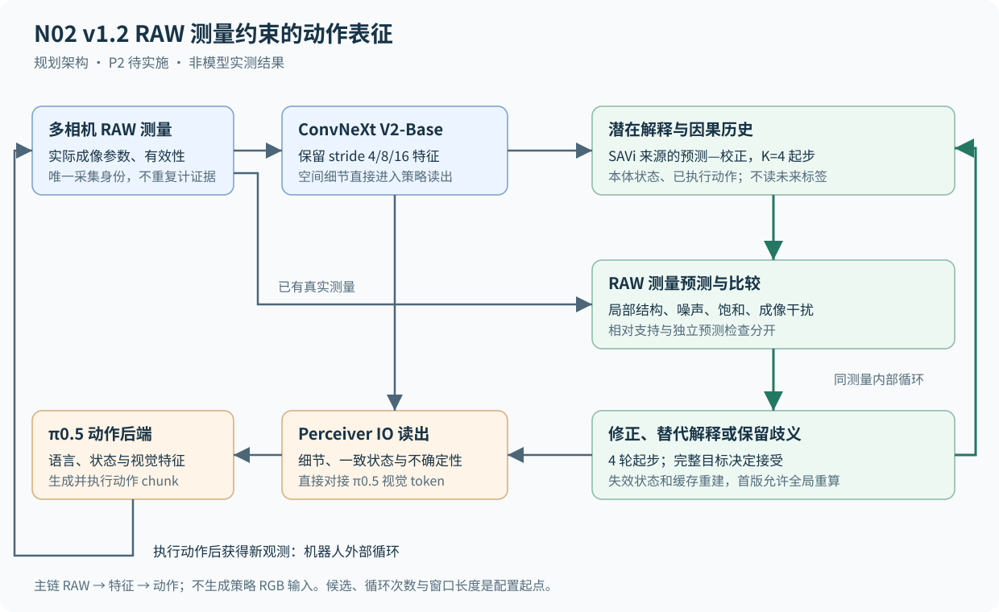

# N02 v1.2 RAW 测量约束的动作表征编码器技术方案

版本：v1.2。采用日期：2026-10-15（Asia/Shanghai）。状态：正式采用；P2 完整实现待实施。当前执行修订为单种子1103、每个实际选中模型共100次闭环；[DeepSeek完整阶段包](../prompts/n02_v1_2/README.md)已备，新机部署见[实际记录](../../research/experiments/2026-10-15_n02_v1_2_remote_deployment.md)。

N02 直接利用 RAW 中保留的动作相关弱测量，通过受测量约束的循环推断形成和修正表征，再将表征交给 π0.5 生成动作。研究主线是“RAW 信息增量如何转化为动作能力”，对象状态、多假设和状态撤回用于实现这条主线。

本方案取代 [v1.1](N02_full_development_plan_2026-10-13.md) 中后续逐阶段扩建组件的路线，采用 **P2 完整实现 → P3 充分训练与整体比较 → P4 独立确认与100次闭环**。P0 的已验收基础继续复用；P1 独立验收未通过的事实保留，其接线、数据与评测修复并入 P2。采用记录见 [0015 决议](../decisions/0015-n02-v1-2-route.md)。

## 1 研究目标与核心假说

### 1.1 从 RAW 测量到机器人动作

弱光下，夹爪与杯沿之间可能只有很弱的间隙。去噪、裁剪、色调映射或量化可能削弱这条线索，RAW 中仍可能保留空间上连贯的差异。编码器应判断这些差异是否足以反驳“已经抓住杯子”，修正潜在状态，使 VLA 改变动作。这是拟验证的行为例子，不是现有模型的演示结果。

完整因果链为：

```text
RAW 保留动作相关测量
    → 编码器利用实际噪声、有效性和成像条件判断测量
    → 弱但一致的线索约束或纠正潜在解释
    → 修正后的空间特征、状态与不确定性进入 π0.5
    → 动作与闭环任务结果发生可验证的改善
```

核心假说是：**利用 RAW 中保留的弱测量及其噪声结构，可以使循环推断更有效地形成动作表征；可靠测量与当前解释冲突时修正表征，测量尚不可辨识时保留歧义。**

### 1.2 RAW 优势的适用条件

| 可能保留的信息 | 编码器需要做的事情 | 需要排除的错误归因 |
| --- | --- | --- |
| 被显示处理削弱的低对比边缘、细小间隙和局部结构 | 保留高分辨率特征，以空间上连贯的差异区分解释 | 将更大网络或更多像素误当 RAW 信息优势 |
| 更接近线性的响应及实际曝光、增益条件 | 将观测变化与成像变化分开建模 | 把曝光改变自动解释成物体移动 |
| 信号相关噪声、有效性与饱和信息 | 根据测量可靠性评价解释，同时保留弱但一致的结构 | 按亮度直接压低所有暗区域的权重 |
| 未被固定显示目标压缩的测量 | 直接学习动作特征，无须先生成供人观看的图像 | 仅因输出不是 RGB 就宣称新方法成立 |

RAW 不保证比任意 RGB 表示包含更多任务信息。若 RGB 由同一 RAW 可逆变换得到且精度充分，未必有信息差；若源测量已饱和或没有采到足够光子，也不能靠循环恢复不可观测事实。改进可能来自信息保留，也可能来自更适合学习的表示，两者分别解释。[R01]、[R02]

### 1.3 拟贡献与已有边界

拟研究的规则是：让动作相关潜在解释产生 RAW 域测量预测，以实际噪声与有效性约束判断解释差异，并将比较结果反馈到空间表征与状态更新，最终由动作与闭环评价其价值。

RAW 输入、动作监督、循环状态、对象槽、多假设和依赖重建均有已有方法。RawVLA 已有动作驱动的流式神经 ISP，RAW-Adapter 和 Dr. RAW 已覆盖 RAW 适配与任务条件化，SWB 已覆盖对象级多假设。引用或组合这些机制不自动构成新贡献。[R01]、[R03]、[R04]、[R08]

需要通过同源 RAW/RGB 四臂、普通循环/多假设强对照和测量干预，确定新规则是否更有效地利用了 RAW 保留的动作线索。若收益同样出现在 RGB 且无法定位到 RAW 测量，应限定为通用推断或表示收益；若相同 RAW 下普通编码器同样有效，也不能归因于 N02 机制。

## 2 数据与输入边界

### 2.1 RawVLA-Bench 的实际表示

| 平台或表示 | 实际来源 | 可支持的研究结论 |
| --- | --- | --- |
| LIBERO pseudo-RAW | 已色调映射的 RGB8 经固定 unprocessing 形成三通道 pseudo-RAW | 处理适配、表示与操作收益；不能证明恢复了源 RGB8 已丢失的信息 |
| RoboTwin HDR-derived RAW | SAPIEN 预色调映射 HDR 缓冲形成三通道测量，并加入信号相关噪声 | 更适合检验显示处理前信息的动作价值；仍需核对实际裁剪、噪声与 RGB 管线 |
| 原生 Bayer CFA | 独立输入模式，需要真实采样、标定和配对数据 | 当前 RawVLA-Bench 主实验不能提供 CFA 采样结构的能力结论 |

两个平台按实际来源分报，不将三通道 RAW 称为原生 Bayer，不把存成高位深数组视为信息增加。[R01]

### 2.2 允许进入推断的信息

输入包括当前和因果历史 RAW、实际可用的相机/成像参数、有效性、任务语言、本体状态与历史已执行动作。缺失参数明确标为未知，不根据任务标签补造。多相机时间、坐标与变换对应关系需要保留。

未来专家动作仅作训练标签。正常光配对 RGB、仿真隐藏物体状态、接触真值、深度或真实框不进入正式推断，也不用于从真值构造候选。主链不生成 RGB/sRGB/XYZ 图像供策略使用，不以 RGB 教师或 RGB 重建训练 RAW 主表示。

### 2.3 拆分与同源比较

沿用已验收的源轨迹分组与划分入口，区分训练、开发和校准；正式测试初态独立。相邻帧、同轨迹照明派生版本与观测干预版本跟随源轨迹，不跨区。当前源身份不足以支持的物体/场景互斥划分不冒称已经建立。

四臂的 RGB 必须由**同一次 RAW 测量**经固定、已声明的 ISP 得到。官方正常光 RGB 参考与退化 RAW 可能来自不同照明条件，不能作为同信息对照。RGB 显示映射、裁剪、量化和去噪各项分别记录；需要检验信息损失时增加相应处理的单因素对照。

训练以官方 RAW 序列和专家动作为主体。诊断干预从官方轨迹派生，并保存其作用位置和强度；不得用自造几何生成器的表现代替主实验。涉及物体真实变化、正确动作随之变化的扩展任务，必须具有有效专家动作或重新规划，不能机械复用原标签。

## 3 完整架构与模块来源



图示为待实现架构。蓝色为直接空间特征，绿色为测量约束推断，橙色为动作读出。内部循环解释已有测量，外部机器人循环才获得下一次新观测。

### 3.1 首版网络配置

| 模块 | 正式起点 | 来源与迁移范围 |
| --- | --- | --- |
| RAW 编码器 | ConvNeXt V2-Base；depths `[3,3,27,3]`、dims `[128,256,512,1024]` | 官方结构约 89M 参数；复用 P0 核验的移植，RAW 通道、矩形与有效性属于适配差异 [R05] |
| 空间表示 | stride 4/8/16 多尺度，保留相机与坐标 | 不先将全图压成一个向量；本方案扩展应单独验证 |
| 潜在状态 | SAVi 来源的预测—校正，16 槽、宽 512 起步 | 循环与注意力块复用有来源实现；宽度和槽数为本方案配置 [R06] |
| 候选解释 | `K=4` 起步，网络提出并可更新候选内容 | 是竞争解释数量，不是观测数量；不由真值构造答案字典 |
| 循环更新 | `R=4` 轮起步，共享更新模块 | 另测 1/2/4/8 轮的质量—成本，不将多算当作新证据 |
| 测量预测 | SAVi 来源的解码/空间组合结构适配 RAW 输出 | 预测值只用于推断和辅助训练，不写回观测；改变目标后的能力不继承 RGB 成绩 |
| 策略读出 | Perceiver IO 来源；每相机 256×2048 tokens 对接既有桥 | 读出参数与开销计入前端，具体接口以已冻结桥验证 [R07] |

这些是完整首版的起始配置，不是最优值或原论文整套训练配方。架构、源码、权重和训练数据来源分别记录。新网络采用 RAW 自监督学习的主路线，不默认沿用未充分训练或存在泄漏的 P1 检查点。

SAVi/Perceiver 的官方实现涉及 JAX；使用既有经数值核验的 PyTorch 移植或做限定移植，不重新写一个小参数量近似网络来代替正式模块。新增接口差异只做必要核验。SCALOR、dNRI、Theseus、Gen 和 iSAM2 用作相应能力的参考或强对照，不要求将它们全部堆入首版主链。[R09]、[R10]、[R11]、[R12]

### 3.2 直接特征与潜在解释共同读出

直接空间通路保留夹爪边缘、接触位置等细节；推断通路组织潜在结构和历史。策略读出同时消费空间特征、一个一致候选的状态与歧义信息。不能将互斥候选直接平均为不存在的中间场景。

直接通路可能使策略忽略推断分支，因此要通过冻结、替换或关闭分支的动作干预，确认表征修订确实参与决策。推断分支的 attention 可视化不是这一点的充分证据。[R15]、[R16]

## 4 状态与实际计算过程

### 4.1 状态及生命周期

| 状态 | 内容 | 生命周期 |
| --- | --- | --- |
| 测量集合 `M` | episode/camera/frame/acquisition ID、原始值、单位、有效性与标定版本 | 一次采集只提供一次证据；episode reset 清空；窗口外保留必要重放引用 |
| 空间特征 `X` | 多尺度、带坐标和相机身份的 RAW 特征 | 由测量派生，不额外提供独立观测 |
| 候选状态 `H[1:K]` | 槽/局部结构、跨视角关联、历史状态与成像干扰解释 | 每个候选是一套自洽解释；槽下标不是永久物体身份 |
| 支持权重 `q` | 声明先验与固定目标下的候选相对支持 | 默认不宣称校准概率；新候选集合或目标改变后重新计算 |
| 预测检查 `C` | 预先锁定的因果预测、残差与校准结果 | 预测版本固定，不能拟合后覆盖原检查 |
| 重建记录 `J` | 状态/模型/测量版本、实际计算依赖和随机输入 | 用于重放与缓存失效；不等同于物理因果图 |

初始化只使用允许的观测、历史与声明先验。推理期间冻结网络权重，动态变化的是状态和解释。窗口内观测与窗口外历史摘要的统计支持不能重叠计数。

### 4.2 一次决策的执行顺序

1. 接收并核对本次实际新测量；复用同一 ID 不再次增加证据。保留完整有效区域，禁止旧固定 stride 查询造成单一采样相位盲区。
2. 在读入当前帧前，从因果历史锁定预测检查；当前帧拟合和锁定检查走不同的数据版本。
3. RAW 编码器提取多尺度空间特征；由历史、本体状态与已执行动作传播状态，再结合当前特征提出候选。
4. 每个候选预测 RAW 测量，先考虑声明的成像干扰，再计算完整测量目标、局部残差及解释间判别力。
5. 在同一测量集合上展开循环：提出修正、重算完整目标、接受有效更新；必要时提出替代解释或重建状态。
6. 输出相对支持、绝对检查及残余歧义；由一致候选、直接空间特征和不确定性读出视觉 tokens。
7. π0.5 生成动作 chunk，按固定协议执行；实际执行信息与下一次观测进入下一个决策时刻。

候选来自学习过程，不能读取真值答案。候选内容可以因残差刷新，不限于给预置类别重排序；“新解释”仍限定在模型容量和可表达结构内，不保证开放世界发现。

### 4.3 修正与撤回

当新测量反驳解释时，原始测量不删除，失效的是解释及其派生状态。直接调低权重后继续使用被污染的循环隐状态或策略缓存，不算完成修订。首版通过全局重算或检查点重放实现正确重建，不默认承诺局部提速。

复杂关系图、变维搜索、完整通用真值维护和局部传播不是独立阶段前置。确有证据需要时作为 P3 后的有依据扩展，并在相同表示、信息和预算下比较。N02 不通过扩大曝光或额外主动动作获取信息；此类增量分别属于 N01/N06 的对照边界。

## 5 RAW 测量约束与三态检查

### 5.1 条件测量目标

以候选 `H`、成像干扰 `eta`、已知条件 `c` 预测传感器域均值与必要分布参数。单位、黑白电平与实际归一化变换在打分前一致；早期标定、方差与尾部概率优先 FP32。

在独立 Gaussian 近似成立的局部子问题中，单项可写为：

```text
ell_j = 0.5 * ((y_j - mu_j)^2 / sigma_j^2 + log(sigma_j^2)) + constant
```

方差归一化项不能省略，不能通过无限放大预测方差规避误差。实际存在相关噪声时使用联合模型或条件增量；量化与饱和使用对应区间/尾部概率；无法建立可信密度时明确退回经验能量。首帧差分作为独立对照，其共享参考噪声不能被当成独立帧似然相乘。[R02]

多尺度重叠区域只提供同一测量的派生表示，不将其似然重复累加。用于训练日志的每标量平均损失与用于声明证据的总目标分开，不能把随意缩放的均值 softmax 叫作真实后验。

### 5.2 弱测量的判别力

解释间差异相对于噪声的大小，决定测量是否足以区分候选。对于共享、已知协方差的 Gaussian 子问题，可用 `d^2=(mu_i-mu_k)^T Sigma^-1 (mu_i-mu_k)` 研究区分能力；该假设下 KL 为 `d^2/2`。这是明确模型下的性质，不外推到未知噪声与任意神经状态。

局部指标用于定位“信号是否还在、网络是否利用”，不是独立的长期优化目标。重点观察与夹爪间隙、边缘或接触状态有关的一组一致差异；不能因全图背景占多数而抹掉它们。

### 5.3 相对偏好与绝对检查

| 输出 | 回答的问题 | 实际处理 |
| --- | --- | --- |
| 候选相对支持 | 哪种解释更符合声明目标 | 先验与能量共同决定；不自动等于世界概率 |
| `compatible` | 当前模型与观测是否相容 | 保留可用解释，继续动作读出 |
| `insufficient_information` | 可用测量是否不足以区分解释 | 保留歧义；不能强制选择更自信答案 |
| `model_inadequate` | 当前解释族是否无法说明观测 | 检查成像干扰、提出替代解释或重建状态 |

判定使用完整推断流程对应的独立校准集。若候选选择、反复查看或拟合复用了检查测量，需对包含这些步骤的整个流程校准，不能继承一个独立单次检验的误报率。缺失 verdict 是无效结果，禁止转成 `None` 字符串后计作 0 误报。固定窗口结果不扩张为任意时刻保证。[R14]

## 6 理论性质及其边界

### 6.1 固定候选下的支持更新

固定模型、测量集合与有限候选，令每个候选初始质量 `p0(h)>0`、温度 `tau>0`、能量有限：

```text
q* = argmin_q [sum_h q(h) E(h;M) + tau KL(q || p0)]
q*(h) = p0(h) exp(-E(h;M)/tau) / sum_g p0(g) exp(-E(g;M)/tau)
```

这是有明确变分目标的广义更新。[R13] 在候选与参数固定时，所有候选增加相同代价则相对权重不变。两候选、错误先验 95% 的例子中，正确候选胜出需能量优势大于 `tau*log(19)`。实际无信息场景通常仍有随机差异，其漂移与校准必须实测。

学习/剪枝候选和优化连续状态属于近似搜索。比较不同结构的最优能量 softmax 不自动包含连续体积、提议概率或 Jacobian；不据此宣称精确 Bayes、SMC 一致性或 MCMC 正确性。重复候选也不能凭复制得到额外先验质量。

### 6.2 去重与重建一致性

目标按唯一测量集合定义，重复 ID 不改变目标。多轮内循环可以改善近似解，但不增加证据；前缀重放只能替换整段目标或加入严格条件增量。

若重建记录完整包含实际依赖、固定程序版本及随机输入，按依赖重新执行应等于更新输入后从头执行。全局注意力可能使依赖是全局的，不能为了局部性省略依赖。该性质保证计算一致，不保证解释为真。[R11]

### 6.3 固定问题的接受规则

固定模型、测量与结构时，学习校正器只提出更新，最终接受要求完整目标不增。带回溯的梯度/标准求解步骤可作为参考，有限预算输出最好已见状态与剩余残差。目标下界有限时接受能量序列有极限；不由此推导迭代点收敛、全局最优或任务成功。网络训练、新测量与结构变化后，重新界定固定问题。

上述性质是与代码对应的研究约束，不是新的通用推断定理。N02 的贡献仍需要 RAW 信息与动作实验共同建立。

## 7 π0.5 接入与训练

### 7.1 后端与梯度边界

替换视觉塔及相关图像预处理，保留已冻结的语言、本体与动作语义。训练和推理共同使用 RAW 特征桥。LIBERO/RoboTwin 的动作维度、horizon、offset 与归一化沿已验收协议；特别保留 RoboTwin checkpoint 的显式 MEAN_STD 规则。

动作监督更新编码器、连续校正与读出中声明可微的路径；硬候选选择的梯度边界单独记录。不能以选中路径存在非零梯度，宣称整个离散搜索已接受动作监督。候选提议与测量头通过 RAW 目标学习，不使用真值候选标签捷径。

先适配新前端与读出，再以统一规则适配动作后端。所有受控臂采用相同后端起点、解冻/适配容量和预算；原官方 RGB 系统保留为独立强参照，不以故意削弱的 RGB 臂替代它。

### 7.2 数据与损失

先做官方训练池 RAW 掩码预训练，再训练完整循环与动作链路。首版目标为：

```text
L = L_action + lambda_raw L_masked_raw
             + lambda_pred L_causal_raw_prediction
             + lambda_noise L_noise_calibration
```

`L_action` 使用 π0.5 原生 flow-matching 目标；RAW 掩码与因果预测采用各自明确的观测条件。掩码目标不能通过完整当前帧特征泄漏目标像素；空间相关噪声需要处理。因果检查在看到目标帧前锁定。噪声目标只在有相应真实条件或可校准残差时启用，不虚构噪声真值。

同一目标像素的掩码训练项、因果训练项与多尺度特征不是多份独立观测。几何/关系辅助监督只有数据确实提供且对照等权可用时另立实验。损失权重在开发集确定，检查实际激活与梯度，不增加大量各自必须刷通的代理门槛。

### 7.3 充分训练与资源起点

| 部分 | 起始预算 | 有效 batch 与时序 |
| --- | --- | --- |
| RAW 自监督预训练 | 100k 更新 | 256 帧；官方源轨迹拆分内采样 |
| 完整 N02—π0.5 适配 | 50k 更新 | 32 个决策锚点，每锚点 8 帧因果历史；内部 4 轮 |
| 表示与计算消融 | 根据整体结果安排 | 改变的部件单独控制，其余样本与预算匹配 |

微 batch、梯度累积和双 GPU 分配由完整链路画像决定。200 步画像用于资源估算与接线检查，不是独立研究阶段。上述预算取代旧 P1—P5 每阶段长训的逐项叠加，不等同于充分训练已经成立。

首轮每平台/方法一个训练种子，默认 1103；如确认性复现扩种子，另行记录。受控四臂可以共享同模态预训练起点以隔离机制增量，但必须披露共享条件，不能称为完整独立预训练复现。平台后端分别适配，不将两个平台结果当作同一任务的重复样本。

采用固定开发样本、固定噪声/flow 时间等评价条件，结合动作误差、修订视频和独立开发闭环选模。训练 loss 下降不能代替动作进步。100k/50k作为本轮资源计划，完成预算后报告实际结果，不要求loss单调、连续改善或达到平台期，不因没有提升而无限续训；需要延长列为后续建议。短适配只证明连接；当前不增加确认性训练种子。记录数据曝光量、学习率和成本。

## 8 同源四臂与强对照

### 8.1 分开输入收益与机制收益

| 臂 ID | 输入 | 编码方式 | 主要问题 |
| --- | --- | --- | --- |
| `rgb_base` | 同源 RAW 经固定 ISP 得到的 RGB | 成熟 Base，匹配历史的普通融合 | RGB 基础能力 |
| `raw_base` | 同一源 RAW | 同等级 Base，匹配历史的普通融合 | 保留 RAW 是否已经足够 |
| `rgb_n02` | 同源 RGB | N02 循环结构，使用 RGB 域对应观测目标与校准 | 通用循环收益有多大 |
| `raw_n02` | 同一源 RAW | 完整 RAW 测量约束 N02 | RAW 线索与推断机制的联合价值 |

`rgb_n02` 采用相同的候选、循环和读出容量，其观测目标对应实际 ISP 后的 RGB 变量，不能直接套用 RAW 噪声方程。普通融合臂获得相同因果历史、任务和已执行动作，不把额外历史混入机制收益。

两组 RGB/RAW 的骨干容量、初始化规则、训练池、更新数、样本曝光、调参和后端容量匹配；同时报告自然计算差异。充分调优后的系统能力与受控比较分开。若按同预算更宽或更多前向的普通前端可解释收益，也应保留该成本匹配对照。

### 8.2 必要的机制与系统对照

- 官方 RGB π0.5 与强学习 ISP→RGB→VLA，例如 RawVLA；使用可复现实现与适配预算，不将原论文数值直接当本机对照。[R01]
- 相同 RAW 编码器下的普通循环或多假设方法；在相同测量模型、提议集合和重算预算下比较，避免换了更强评分器后归因更新规则。[R06]、[R08]
- 关闭测量反馈、固定噪声/忽略有效性、单候选、单轮、关闭状态重建等消融，按已观察到的整体问题安排，不要求每次修改全矩阵重跑。

### 8.3 能力判断

`raw_n02` 对 `rgb_n02` 衡量输入差异，对 `raw_base` 衡量机制增量。结合四臂交互与置信区间，观察机制是否特别利用 RAW 保留的线索；考虑成功率天花板，不以单个交互数值作为普适判据。

只有总体任务提升，不能证明机制成立；只有局部测量指标提升，不能证明 VLA 受益。证据需要连到“线索仍存在 → 模型利用 → 表征修订 → 动作改变 → 闭环结果”。无显著 RAW 增量、无机制增量、只在个别条件有效等结果均保留并限定主张。

## 9 诊断可视化与闭环评价

### 9.1 固定官方轨迹上的同步画面

| 画面 | 需要看清的实际行为 |
| --- | --- |
| 原 RAW 固定显示映射、同源 RGB 与局部放大 | 模型可用的信号是否被 ISP 削弱 |
| attention、槽或局部支持区域叠加 | 表征聚焦位置及其时序稳定性 |
| 候选 RAW 预测、局部差异与噪声尺度 | 哪些测量支持或反驳某种解释 |
| 每轮能量、支持权重与三态检查 | 修正是否真正改善声明目标，或仍有歧义 |
| 被修订状态、重建范围与缓存版本 | 旧错误是否仍污染后续读出 |
| 预测/实际动作、物体行为与任务结果 | 表征更新是否改变控制 |

attention 还需结合高支持区域遮挡、等面积随机遮挡、历史替换等干预，不能仅凭热力图宣称因果作用。所有画面来自实际运行；主结果保留固定抽样的成功与失败，不只挑成功视频。示意架构图与模型结果明确分开。[R15]、[R16]

### 9.2 评价层次

主指标为平台及各照明域操作成功率，辅以动作位置/旋转/夹爪误差、异常动作、反证后恢复与正常条件退化。测量差异、先验漂移、残差与校准用于解释。统一报告包含读取、传输、全部候选、内循环、状态重建、读出与策略的 p50/p95 时延、显存和持久状态。

场景/源轨迹/初态是主要独立单位；同一初态的多照明版本按簇处理。单训练种子的 episode 区间不表示训练种子间稳定性。开发闭环使用独立初态，不以正式测试失败反复选模。

### 9.3 当前100次闭环与历史完整协议

按用户最新执行要求，每个实际选中模型共100次闭环，seed1103训练一次；不要求每任务/每域100条、不要求三种子或四臂全跑完才能交付。默认RoboTwin为RAW信息研究主平台，从作者原主manifest按任务/照明域分层选100条、比较臂共享身份；如果P3已预先安排双平台，则总100分为LIBERO50＋RoboTwin50，分平台报告。不能事后换平台或挑成功样本。

正常失败计入分母，基础设施异常保留attempt并修复后重跑同一身份。报告成功s/100、任务/照明域计数与实际成本；未完成只报s/n。开发排错只需少量独立初态，不在每次保存点重复100条。单训练种子的episode区间不代表跨训练稳定性，相关初态的照明变体不算独立场景。

原LIBERO10,000＋RoboTwin3,250、附加632及四臂53,000属于历史完整协议与未来可选扩展，当前不执行、不作为验收门槛。历史Default π0.5完整结果LIBERO58.20%、RoboTwin15.63%见[完整基线报告](../../../../repo/research/experiments/2026-10-14_rawvla_pi05_complete_evaluation.md)；100条子集不可与其直接按同分母比较。

## 10 实施阶段与交付

### P2：完整编码器与真实 VLA 链路

一次交付完整 RAW 前端、候选解释、测量比较、循环修正、状态重建、π0.5 接入、训练/评测入口与诊断可视化。修复 P1 的先验丢失、校准器未调用、字段错配、候选标签捷径、数据重叠和伪线索交换。详见[P1 独立验收](../../research/experiments/2026-10-15_n02_p1_independent_acceptance.md)。

复用 P0 已核验组件及冻结数据入口，不要求先把旧合成题刷过门槛。用真实 RAW 窗口验证完整前向、必要梯度、先验影响、实际三态结果、episode reset 与保存恢复；短运行/画像只作为连接证据。阶段交付包含可运行完整模型、真实动作训练的首个保存点（默认1000更新，P3接续）、配置、真实轨迹可视化、简洁实时监控网页、成本画像和下一步训练配置。P2 当前待实施。

### P3：充分训练与整体比较

对同一个完整架构进行 RAW 预训练和完整动作适配，首轮单种子优先建立有效主模型，再按明确问题安排四臂、强对照和消融。开发评价以完整动作与修订行为为中心。比较遵循相同信息、容量和预算；按优先级报告已完成臂，缺项限制主张，不以四臂/全部消融/学习ISP矩阵齐全阻塞交付。

交付训练模型与实际更新数、固定开发曲线、完整轨迹视频、整体比较、失败归因和成本。修改模型时只补受影响验证，避免无依据地反复全量训练。

### P4：独立确认与100次闭环

冻结模型与选模规则，独立进程重载和确认关键机制，再执行所选模型共100条闭环及必要开发干预。最终说明 RAW 输入收益、机制收益、实际动作影响与适用条件。本轮仅seed1103，不额外扩种子，不能将未执行部分标完成。

交付每平台/照明域任务结果、失败身份、可追踪模型/配置、原始小型记录与完整成本，以及主张—证据对应。复杂关系、变维搜索、局部加速和原生 CFA 扩展，只能依据这轮明确缺口另行立项。

## 11 工程组织与历史处理

### 11.1 必要接口与代码职责

保留 `src/owac/frameworks/n02_full/` 为当前实现位置、`training/n02_full.py` 与 `evaluation/n02_full/` 为训练和评测入口、`owac.backends.rawvla_features` 为策略桥。按 RAW 适配、空间编码、候选状态、测量目标、校正、重建与读出组织职责。核心算法应能从一条清晰主循环追踪到真实动作；减少多重别名、静默默认值和庞大兼容分支。

必要检查集中在单位、shape、有限值、因果性、数据隔离与真实输出接线。缺失结果显式失败或未运行，不用“防御性”回退生成看似正常的科研统计。保存实际配置、训练状态、更新计数和小型追溯记录，不将逐文件全量哈希或海量代理测试当作能力证据。

### 11.2 新服务器、实时监控与授权范围

本地目录`/home/jeong/zeno/owac/worktrees/n02-measurement-completion`，活跃远端`/workspace/owac/worktrees/n02-measurement-completion`。新登录指令`ssh -p 51584 root@93.91.156.102 -L 8080:localhost:8080`，旧服务器停用。数据根`/workspace/owac/rawvla/source/benchmark_data/RawVLA-Bench`，实际部署项见[部署记录](../../research/experiments/2026-10-15_n02_v1_2_remote_deployment.md)。两张约96GiB GPU，默认GPU0 RAW、GPU1 RGB，训练和验证均可分卡并行，独立run/策略端口/仿真输出。

远端8080由平台Jupyter占用，研究监控监听127.0.0.1:18080，SSH额外加`-L 8081:localhost:18080`后访问本机8081。P2调用前端专家完成单页实时监控：当前工作、心跳、两GPU进度、loss/dev曲线、真实attention/残差图和闭环n/100；标准库HTTP加原生HTML/JS即可，断线后由supervisor保持运行。阶段包内有完整委派任务和状态字段。

当前授权为Codex部署新机代码/环境/资产并编写P2—P4自包含提示词；未授权Codex在本轮替DeepSeek实现N02或启动长训练。用户交付某阶段包后，DeepSeek按该阶段实际开发/训练/交付，再停止。HF凭据只用于远端私有认证，不入Git、提示词或网页。

### 11.3 历史证据与版本替代

P0 implementation/numerical 已验收的范围保留；P1 的独立验收仍为未通过，不因采用 v1.2 改判。旧 v1.1 P2—P7、E1/E2 仅用于历史回查，不再作为串行执行门槛。旧局部调度与负结果、CFA4 合成诊断、原检查点均保留，不能直接充当新 RAW3 主模型的能力证据。

当前能力状态：v1.2 设计已采用，完整实现、充分训练、RAW 增量与机制增量、机器人闭环收益均待验证。

## 12 文献与实现来源

下列来源提供已有方法和理论依据，不证明本方案迁移后的效果。具体复用文件与差异沿用 [P0 组件记录](../../src/owac/frameworks/n02_full/components/README.md)、[固定源码导航](../prompts/n02_v1_1/02_REFERENCES.md)；后者属于历史参考，不是当前阶段任务。

- **R01 RawVLA**：流式神经 ISP、动作驱动优化与 RawVLA-Bench。最接近的具身系统对照。[论文](https://arxiv.org/html/2609.37530v1)、[项目](https://shuhongll.github.io/rawvla/)。
- **R02 Unprocessing Images for Learned Raw Denoising**：噪声及处理管线的建模依据。[论文](https://arxiv.org/abs/1811.11127)。
- **R03 RAW-Adapter**：RAW 输入与预训练视觉模型适配的已有边界。[论文](https://arxiv.org/abs/2408.14802)。
- **R04 Dr. RAW**：传感器条件与任务适配。已检查的作者仓库仅有 README，不列作可直接搬入的完整实现。[论文](https://papers.neurips.cc/paper_files/paper/2025/hash/20eadb6338a53114a6371f102c5ded95-Abstract-Conference.html)、[作者仓库](https://github.com/WJ-Huang/Dr-RAW-Towards-General-High-Level-Vision-from-RAW-with-Efficient-Task-Conditioning)。
- **R05 ConvNeXt V2 / FCMAE**：正式视觉骨干和掩码预训练。[论文](https://arxiv.org/abs/2301.00808)、[官方代码](https://github.com/facebookresearch/ConvNeXt-V2)。
- **R06 SAVi / SAVi++**：预测—校正与对象状态；原监督条件不能随迁移省略。[SAVi](https://arxiv.org/abs/2111.12594)、[SAVi++](https://arxiv.org/abs/2206.07764)、[官方代码](https://github.com/google-research/slot-attention-video)。
- **R07 Perceiver IO**：结构化输入到查询输出的读出。[论文](https://arxiv.org/abs/2107.14795)、[作者代码](https://github.com/google-deepmind/deepmind-research/tree/master/perceiver)。
- **R08 Structured World Belief**：对象级多假设、SMC 与遮挡持续性。[论文](https://proceedings.mlr.press/v139/singh21a.html)。
- **R09 SCALOR / dNRI**：发现、存在性与预测关系的近邻，不作为额外首版必选层。[SCALOR 作者代码](https://github.com/JindongJiang/SCALOR)、[dNRI 作者代码](https://github.com/cgraber/cvpr_dNRI)。
- **R10 Theseus**：有来源的连续优化参考。[论文](https://arxiv.org/abs/2207.09442)、[官方代码](https://github.com/facebookresearch/theseus)。
- **R11 Gen**：程序化推断、依赖与增量重执行参考。[项目与论文入口](https://www.gen.dev/)、[代码](https://github.com/probcomp/Gen.jl)。
- **R12 iSAM2**：增量求解的已有边界，不意味着任意神经能量可精确局部求解。[论文入口](https://publications.ri.cmu.edu/isam2-incremental-smoothing-and-mapping-using-the-bayes-tree)。
- **R13 Bissiri, Holmes and Walker**：损失与 KL 约束的广义更新。[论文](https://arxiv.org/abs/1306.6430)。
- **R14 Conformal Prediction Beyond Exchangeability**：校准条件与分布变化的边界。[论文](https://arxiv.org/abs/2202.13415)。
- **R15 Attention is not Explanation**：可视化需要配合实际干预。[论文](https://aclanthology.org/N19-1357/)。
- **R16 Present but Not Remembered**：区分信息可解码与实际参与动作，结论限于作者冻结开放环审计。[论文](https://arxiv.org/html/2607.03372v1)。
- **R17 MemoryVLA / MemBodied**：VLA 历史与记忆的强近邻，不将“增加记忆”作为 N02 创新。[MemoryVLA](https://shihao1895.github.io/MemoryVLA/)、[MemBodied 作者代码](https://github.com/declare-lab/MemBodied)。
- **R18 SlotContrast / GeoCo-SAVi**：时序一致性与可编辑状态参考；前者公开配置依赖 DINOv2，后者具有明确几何和评价范围，不能直接继承 RAW 操作能力。[SlotContrast 作者代码](https://github.com/martius-lab/slotcontrast)、[GeoCo-SAVi](https://arxiv.org/html/2609.06628v1)。

[R01]: https://arxiv.org/html/2609.37530v1
[R02]: https://arxiv.org/abs/1811.11127
[R03]: https://arxiv.org/abs/2408.14802
[R04]: https://papers.neurips.cc/paper_files/paper/2025/hash/20eadb6338a53114a6371f102c5ded95-Abstract-Conference.html
[R05]: https://github.com/facebookresearch/ConvNeXt-V2
[R06]: https://github.com/google-research/slot-attention-video
[R07]: https://arxiv.org/abs/2107.14795
[R08]: https://proceedings.mlr.press/v139/singh21a.html
[R09]: https://github.com/JindongJiang/SCALOR
[R10]: https://github.com/facebookresearch/theseus
[R11]: https://www.gen.dev/
[R12]: https://publications.ri.cmu.edu/isam2-incremental-smoothing-and-mapping-using-the-bayes-tree
[R13]: https://arxiv.org/abs/1306.6430
[R14]: https://arxiv.org/abs/2202.13415
[R15]: https://aclanthology.org/N19-1357/
[R16]: https://arxiv.org/html/2607.03372v1
