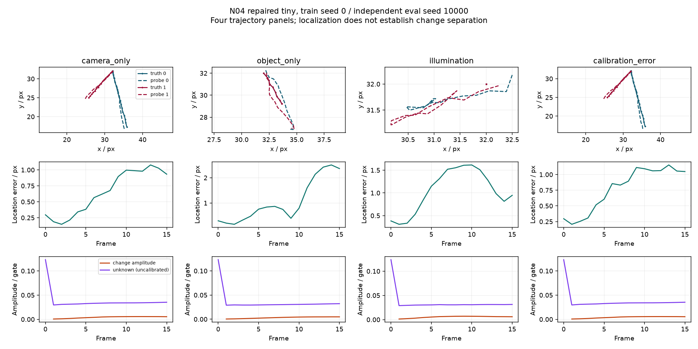

# 2026-10-12 N04 独立复核、修补与验收

## 目的与判定范围

对照[原始实现要求](../../docs/prompts/DeepSeek_N04_implementation.md)复核 `9087190`，不以完成报告或测试数量代替验收。原交付未满足本轮要求：关键层没有进入 optimizer，最近基线未训练，旧定位指标可退化为特征自比较，π0.5 桥使用的 mock 方法不对应固定后端。原报告中的合成数值保留为历史，不能作为修补版本的定位或变化分离证据。

本轮目标是可训练、可比较的小模型纵向链路。负机制结果允许交付；完整 benchmark、充分调优适配、small/medium scaling、机器人任务收益不属于本次 smoke 的通过项。实际读到的数据仍是作者三通道 pseudo-RAW/HDR-derived RAW，不是原生 Bayer 采集。

实现提交：`c13420a9c49843ac0481cb791baf6acc2ddd1b46`；原基点：`90871904744dc1e3e609ff7fae36413ad5227542`。训练 checkpoint 与每个矩阵行的 SHA256 已逐一核对；真实运行使用的源码 archive hash 另列，不冒称所有服务器运行都发生在最终 Git commit 后。

## 独立发现的缺口与实际修补

| 原缺口 | 影响 | 修补与检验 |
| --- | --- | --- |
| 运动 MLP 和分解层在 AdamW 建立后懒创建 | 有梯度也不等于有参数更新；参数数目少报 | optimizer 前 materialize；分解层预建；回归检查传播/分解权重真正更新 |
| 粗网格限幅除以 coarse 宽度，输出却仍按 feature 像素解释 | tiny 的 8px 上限实际约 0.5px | 统一 feature 单位，专门验证 4px 输入不被压至 0.5px |
| 原定位 loss 为特征自对齐，单帧误差可恒零 | 不能证明目标定位，存在塌缩捷径 | 合成目标掩码定位探针；逐样本质心误差/IoU；无探针指标为空；真实数据的自一致性明确是代理 |
| change loss 归一化幅值、跳过静态负例 | 可压缩整个 change 场或对所有变化响应 | 绝对幅值与门控监督，保留静态/照明负例；不可识别近同速条件不硬造标签 |
| block 在重复静态帧引入漂移、多尺度参数未进入输出 | 状态更新与算法语义不符，存字段不能算训练 | 有界残差修正，零输出初始化；低尺度进入损失/读出，检查其参数更新 |
| CFA stem 的 5D 输入，四相位复制成同址通道 | 原生 CFA 前向不成立 | 各平面共享卷积但分别采样，保留滤色语义与实际相位；四相位前向/梯度回归 |
| 无历史首帧读出全无效；部分 reset 清空整批历史；无新测量仍能偷读当前图像 | 证据支持与生命周期失真 | 当前有效测量初始化支持；部分样本历史保留；无新测量不能改变读出；相机/帧缓存 |
| 无效像素在 GroupNorm 之前仍进 stem | 遮挡/坏点内容可影响有效区域 | stem 前屏蔽缺失和饱和；无效区加 100 也不能改变有效输出 |
| 分割照明 variant 身份，而非源演示；强行移动一个 group 到另一侧 | 同源轨迹训练/验证泄漏 | LIBERO dataset/task/demo、RoboTwin task/seed、显式源 episode 分组；空侧精确报错，不拆组 |
| 合成位移取整、rotation flow/目标掩码不一致，delay 只是常量 offset | 条件名不等于真正的运动干预 | 亚像素采样、旋转一致的 flow/掩码、真实延迟上下文；连续目标停运动，无 teleport |
| 五个最近基线无训练入口，错位消融串窗口/相机历史 | 同预算比较不成立 | 统一训练/损失/checkpoint 接口；五基线、四消融、固定 RAW patch、冻结传播均训练 |
| bridge 使用虚构 embed/sample API、语言 mask 全真、动作目标错误 | fixture PASS 不能说明真实 π0.5 接入 | 直接复用固定 StarVLA forward_from_observation/sample_actions；保留语言缩放、padding mask、位置、adaRMS、velocity target；真实权重 smoke |
| checkpoint 恢复后新建层留在 CPU | CUDA 服务真实请求失败 | 新建运动层/探针继承已有参数 device；独立 HTTP infer/reset 实测 |

关键代码：`frameworks/n04/{ego,innovation,model,state,synthetic}.py`、`training/n04.py`、`evaluation/{n04,n04_compare}.py`、`baselines/n04.py`、`raw/rawvla_sequence.py`、`backends/rawvla_{features,feature_smoke,feature_server}.py`。新增 `test_acceptance.py` 与真实 API fixture 回归。fixture 与真实预训练权重结果分开存档。

## 训练、独立矩阵与证据边界

共同训练：tiny 宽度 32、2 blocks、2 scales，64×64，batch 4，序列 12，burn-in 2，TBPTT 8，AdamW lr=3e-4，200 updates，训练 seed 0，GPU FP32。每个对照共享完全相同的合成序列。监督中的目标/几何真值仅供 loss，encoder 不读 oracle。最近基线实现是本仓库的受控简化模型，不是完整复现各论文。

五个最近基线：single-frame CNN、同上下文 ConvGRU、learned-motion + EMA、learned-motion + learnable scalar-gain predict-update filter、action-conditioned recurrence。ConvGRU 与 action-conditioned control 使用相同运动上下文；后者使用独立 transition/correction，二者不再是实现别名。均非充分调优 SOTA。C4 使用 seed 0、逐核 L2 归一化、固定 3×3 RAW 投影；投影无可训练参数。C3/C4 与 N04 采用相同 token 数/宽度及读出模块结构，输入宽度和新增参数数目分别披露。

冻结传播从共同零位移初始化固定传播，其他部分训练；不是“另行预训练出优质传播再冻结”的实验。最近控制没有原生 change cell，其该项为空；不能把空分支的零响应当作良好分离。机制训练使用定位探针和测量预测，readout 不受动作监督；实际动作梯度 smoke 另列，不能说完成了 π0.5 动作适配训练。

独立评测 seeds 10000/10001/10002，camera speed 0.6–2.0、object speed 0.4–1.8、rotation 0–0.7 度/帧，扩大训练范围。9 条件与两种精确配对反事实；恢复以连续两帧 IoU≥0.5 且误差≤2px 判断，未恢复记 censored。变化比是幅值代理，不能称为误报率或分解准确率。三个评测种子共享一次训练，不能冒称三次独立训练的显著性。

小型机器可读归档见 [training.json](results/2026-10-12_n04_acceptance/training.json)、[matrix.json](results/2026-10-12_n04_acceptance/matrix.json)。四条并排轨迹与逐帧数值保留，失败与 unknown 一并展示。

## 实际结果与验收结论

**原交付未完成。本轮修补后，小模型实现/接口验收通过；分离机制的研究验收仍不通过。** 全仓 `uv run --locked --extra encoder pytest -q`：187 passed（两个现有 PyTorch warning）；`make check` 通过。checkpoint 恢复与连续训练在 CPU 回归中逐参数相等；真实服务额外覆盖 CUDA 恢复。

| 配置 | 参数（可训练 / 全部） | 9 条件定位误差均值（px） | 相机/物体变化幅值比 | 照明/物体变化幅值比 |
| --- | --- | --- | --- | --- |
| candidate | 294,990 / 294,990 | 2.149 | 1.396 | 1.744 |
| single_frame | 23,652 / 23,652 | 2.401 | — | — |
| fixed_raw_patch | 13,444 / 13,444 | 13.955 | — | — |
| convgru | 86,044 / 86,044 | 2.956 | — | — |
| motion_compensation | 49,767 / 49,767 | 1.902 | — | — |
| predict_update_filter | 49,768 / 49,768 | 1.980 | — | — |
| action_conditioned_recurrent | 53,756 / 53,756 | 3.890 | — | — |
| n04_no_ego | 268,875 / 268,875 | 3.348 | 2.440 | 1.031 |
| n04_no_change_branch | 294,990 / 294,990 | 2.128 | — | — |
| n04_all_residual_noise | 294,990 / 294,990 | 2.225 | — | — |
| n04_time_shifted_context | 294,990 / 294,990 | 2.256 | 1.363 | 1.716 |
| frozen | 268,875 / 294,990 | 3.224 | 2.613 | 0.923 |

以上为一次训练、三独立评测种子 × 九条件的描述性均值；不是充分调优或显著性结论。候选定位误差 2.149px，高于运动补偿 1.902px 和普通 predict-update 1.980px；去掉变化分支为 2.128px，没有观察到定位增量。纯自运动定位均值 0.930px、纯目标运动 2.516px、照明 1.082px、错误上下文标定 1.108px。目标停运动后的恢复为 0 / censored / 0 帧（三个种子）；不能丢弃中间失败。

H1：幅值比 1.396，仍 ≥1，且上下文错位消融为 1.363；虽然低于无 ego 的 2.440，但没有满足预设的相机变化抑制/对真实变化保留条件。H2：照明幅值比 1.744，仍不支持照明分离。固定 gate≥0.5 下，候选 camera-only 像素误报率均值 2.335%、照明 2.406%，目标移动像素漏报率均值 **49.476%**。这些率以有效、有标签像素逐帧计算再做均值，空正例/不可识别 near-same-speed 条件为空；不是动作误报或事件成功率。小误报率不能掩盖对真实变化的高漏报。

四条实际轨迹：[逐帧 JSON](results/2026-10-12_n04_acceptance/candidate-trajectory-seed10000.json)、[图](results/2026-10-12_n04_acceptance/four-trajectories.png)。保留 unknown、定位偏差和失败；单条图不代替三种子矩阵。



真实权重结果（单 batch，随机新 encoder；不是动作适配效果）：

| 套件 | 视觉 prefix / 内部动作形状 | 动作 loss | 梯度范数之和（传播 / 更新 / readout） | 冻结后端违规 |
| --- | --- | --- | --- | --- |
| libero | [1, 512, 2048] / [1, 10, 32] | 0.42064 | 0.65372 / 0.00019985 / 2763.7 | [] |
| robotwin | [1, 768, 2048] / [1, 50, 32] | 2.48335 | 0.50724 / 2.1724e-05 / 2834.4 | [] |

真实两路 LIBERO / 三路 RoboTwin 观测分别只编码 4 / 6 次（两次时间观测 × 相机数），10 次去噪不增 encoder 调用。HTTP 两套服务各两请求与 reset 通过，完整 actions 留服务器；本地只保留形状、数值范围、hash 和更新计数。

成本另见 [cost.json](results/2026-10-12_n04_acceptance/cost.json)：本地 RTX 5090，随机三通道测量 256×256、batch1、单相机、feature64×64、256×2048 readout，5 warmup + 40 次同步计时。encoder+readout p50 2.119 / p95 2.808ms，readout 单独 p50 0.073 / p95 0.125ms，单相机状态 3,555,336 bytes、readout 参数 727,040。排除传输、tokenizer、冻结后端；服务的完整 HTTP 往返单独记录，只有两次请求不能冒称系统 p50/p95。基准是实现成本 fixture，不能用于任务准确率。共享合成序列生成实际 36.12s，候选训练 loop 22.50s；其他训练时长见 training.json，存在并行进程负载，不把这种 wall-time 差异当架构速度优势。

四种 CFA 各 20 updates、loss/backward 有限，记录 [cfa.json](results/2026-10-12_n04_acceptance/cfa.json)。真实 NPZ 两套各 20 updates，loss 有限、执行动作缺失标记正确，详见同目录 history/data。只有单轨迹 smoke，不能给真实验证成绩。

## 真实 NPZ 与固定预训练后端

隔离服务器目录 `/workspace/owac/rawvla/research/n04-acceptance-20261012/`，通过固定 Python 3.10 StarVLA runtime + PYTHONPATH 运行；不改冻结 benchmark 源码/服务。只同步小报告、配置、hash；checkpoint、NPZ、模型权重和完整日志留服务器。

LIBERO：`libero_10_no_noops_1.0.0_lerobot/episode_000001/variant_00.npz`，两相机 256×256，原 uint8/255 明确归一化，本体 8 维，动作 7×10。RoboTwin：`robotwin2/raw/grab_roller/episode_000000.npz`，三相机 240×320，保持 float32 原量程，已知 white=3.5；用当前 `actions[t]` 的 14 维关节状态，监督为未来 50×14，16 维末端 `robot_states` 不偷换为关节量。没有记录到已执行控制输入，明确 availability=False，不拿未来专家动作补齐。

两套各一源轨迹、20 updates 离线训练，validation fraction=0，仅验 loader/TBPTT/optimizer/checkpoint，不能当真实验证集结果。真实无目标运动/相机 flow 标签，因此 location 记录是 feature consistency proxy，change/ego supervision 为空。

特征 smoke 载入部署中的真实 π0.5 权重、tokenizer、对应冻结 stats（离散状态文本保留 32 维 padding）；LIBERO q01/q99，RoboTwin norm_stats 下的 mean/std。显式允许释放被替换视觉塔，其余语言/动作权重逐项审计；观测只编码一次，10 次去噪复用 prefix。监督只计真实动作维度和有效尾部。传播/更新/readout 梯度必须各 >0，冻结参数梯度必须为空。该 smoke 使用随机新 encoder，证明接口/梯度，不证明动作能力。

独立 HTTP 服务支持 `/infer` 和 `/reset`，真实 NPZ 两个请求产生有限 action chunks，逐相机更新计数 1→2，reset 后清空状态；读出使用上述 encoder checkpoint（仅离线机制代理训练，未动作适配）。服务读取 RAW 测量，返回归一化及按冻结 stats 逆变换的动作；不控制机器人，不是 benchmark websocket 协议的 drop-in wrapper。

结果与资产 hash：[LIBERO feature](results/2026-10-12_n04_acceptance/libero-feature.json)、[RoboTwin feature](results/2026-10-12_n04_acceptance/robotwin-feature.json)、服务报告与 NPZ history/data 同目录。计时分别标明是否包括 encoder/readout/传输；单 batch backend 计时不能替代系统 p50/p95。

## 可直接复现的命令

在本 worktree：

```bash
uv run --locked --extra encoder python -m owac.training.n04 --config configs/encoders/n04/tiny.json --synthetic --steps 200 --device cuda --output outputs/n04-acceptance/candidate
# 五基线和四消融用同一条训练命令加 --baseline <BASELINE_NAMES 中名称>。
# C4: --baseline fixed_raw_patch；冻结传播: --freeze-propagation。
uv run --locked --extra encoder python -m owac.training.n04 --config configs/encoders/n04/tiny.json --synthetic --steps 201 --resume outputs/n04-acceptance/candidate/checkpoint.pt --output outputs/n04-resume --device cuda
uv run --locked --extra encoder python -m owac.evaluation.n04_compare --config configs/encoders/n04/tiny.json --root outputs/n04-acceptance --device cuda --output outputs/n04-acceptance/matrix.json
uv run --locked --extra encoder pytest -q
make check
```

服务器在隔离目录运行，设 `PYTHONPATH=src:/workspace/owac/rawvla/source`，解释器 `/workspace/owac/rawvla/envs/starvla/bin/python`：

```bash
python -m owac.training.n04 --config configs/encoders/n04/libero_npz_smoke.json --npz-dir /workspace/owac/rawvla/source/benchmark_data/RawVLA-Bench/data/libero/raw/libero_10_no_noops_1.0.0_lerobot/episode_000001 --suite libero --npz-limit 1 --val-fraction 0 --output libero-npz
python -m owac.training.n04 --config configs/encoders/n04/robotwin_npz_smoke.json --npz-dir /workspace/owac/rawvla/source/benchmark_data/RawVLA-Bench/data/robotwin2/raw/grab_roller --suite robotwin --npz-limit 1 --val-fraction 0 --output robotwin-npz
python -m owac.backends.rawvla_feature_smoke --suite libero --npz /workspace/owac/rawvla/source/benchmark_data/RawVLA-Bench/data/libero/raw/libero_10_no_noops_1.0.0_lerobot/episode_000001/variant_00.npz --weights /workspace/owac/rawvla/source/openpi_converted_protocol/pi05_libero_starvla/bfloat16/model.safetensors --stats /workspace/owac/rawvla/source/openpi_converted_protocol/pi05_libero_starvla/dataset_statistics.json --tokenizer /workspace/owac/rawvla/source/openpi_converted_protocol/paligemma_tokenizer.model --output libero-feature.json
# RoboTwin feature smoke 使用同模块 --suite robotwin，及 robotwin-feature.json 中记录的 NPZ/weights/stats/tokenizer 路径。
python -m owac.backends.rawvla_feature_server --suite libero --weights /workspace/owac/rawvla/source/openpi_converted_protocol/pi05_libero_starvla/bfloat16/model.safetensors --stats /workspace/owac/rawvla/source/openpi_converted_protocol/pi05_libero_starvla/dataset_statistics.json --tokenizer /workspace/owac/rawvla/source/openpi_converted_protocol/paligemma_tokenizer.model --encoder-checkpoint libero-npz/checkpoint.pt --smoke-npz /workspace/owac/rawvla/source/benchmark_data/RawVLA-Bench/data/libero/raw/libero_10_no_noops_1.0.0_lerobot/episode_000001/variant_00.npz --output libero-service.json
# 持续服务去掉 --smoke-npz，并显式 --host 127.0.0.1 --port 10095。
```

## 未建立的证据

尚无完整 RAWVLA 闭环、机器人任务收益、充分调优 C0–C4 系统比较、跨相机融合或 scaling 结果。原生 CFA 只有合成来源，不能替代实采传感器验证。本轮矩阵不支持 H1/H2，接口验收不会把它们变成已成立。

固定后端源码参考：[PI0.py](https://github.com/ShuhongLL/RawVLA/blob/ba9c56b04da2c4931b70d8844710f5928d43775b/starVLA/model/framework/VLM4A/PI0.py)。运行来源、代码快照、环境、完整 hash 见同目录 run_manifest.json。
