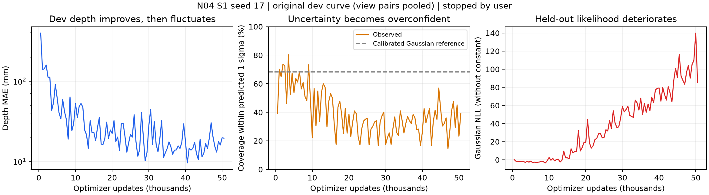

# N04 v1.0 S1 独立效果验收（2026-10-15）

结论：**测量网络学到了有效的深度与描述子，可保留为后续研究输入；S1 全部效果目标尚未通过，主要缺口是方差可靠性和评测正确性。** 本轮实验可以按用户决定提前停止并交接，不以没有跑满 100k 或没有执行另两个种子否决这次交付，也不要求直接补跑剩余预算。

用户在本轮验收中明确要求重点判断效果，并确认提前停止是其决定。本次只读核验既有训练与权重，进行独立开发集诊断；没有恢复训练、启动 S2 或使用 final 拆分。

## 1. 原始要求与验收对象

依据 [S1 提示词](../../docs/prompts/n04_v1_0/S1_raw_measurement.md)、[首版实现合同](../../docs/prompts/n04_v1_0/implementation_contract.md)及[方案 S1](../../docs/plans/N04_full_development_v1.0.md)，本阶段需要完整随机初始化 ConvNeXt-B、独立当前帧测量、真实几何/对应学习、误差和方差诊断、同骨干无记忆基线、可复现权重及测量缓存。

不将本阶段的几何学习直接写成 N04 动态记忆、H1/H2/H3、π0.5 或机器人闭环收益。潜在方差允许按合同固定且注明未校准；本报告的方差否决项针对**实际训练并输出为几何协方差来源的深度方差**，不是要求 S1 提前完成全部 S4。

当前 checkout 为 `/home/jeong/zeno/owac/worktrees/n04-egomotion-separation`，HEAD `a81cf25148870fd83fbc06a4fabf374510493978`，S1 实现尚未提交。远端为 `ssh -p 16724 root@154.59.156.22`。

## 2. 独立证据与身份

远端根为 `/workspace/owac/research/n04-v1`：

| 对象 | 本轮独立核验 |
| --- | --- |
| 源码快照 | `source/n04-s1-20261014T103419Z-d40c91817264`，958 文件逐项 hash，无差异 |
| 完整测量网络 | 88,942,210 参数；骨干四级 depths `[3,3,27,3]`、dims `[128,256,512,1024]` |
| 最终保存权重 | `runs/s1/train-seed17/checkpoint-step0050000.pt`，step=50000，seed=17 |
| 权重 SHA256 | `2ddb0bb1c6050f3c810b048ddb4c4c873b965018c21f1706f4a02cae63f958c7` |
| 实际配置 canonical SHA256 | `e104ea4a7b6af536e779fdbef48271bcd9a4fe4d239f75ea72cd1772392cbcb6`，checkpoint 与 cache 一致 |
| 测量缓存 | `runs/s1/cache-final-step50000`，624 个唯一相机/帧；测量及独立 GT 共 1248 个文件 hash 全部吻合 |
| 真实模型重算 | 每个相机分组抽一帧，共 7 帧；measurement ID 一致，latent/depth/variance 最大绝对差均 0 |
| 作业状态 | seed17、chain、progress 已停止；seed29/43 从未启动；本轮保持该状态 |
| 本地工程检查 | `make check`、`uv run --locked --extra encoder pytest -q tests/encoders/n04 tests/encoders/n04_full`，405 passed，2 个已有 warning |

本地 `training/n04_full.py` 与训练快照仅在 `detect_stability` 及其说明不同，差异另存；其他本轮核对的测量、配置和评测文件 hash 一致。不能用本地修改后的趋稳逻辑冒充运行时实现。

开发证据只有 **4 条机器人源轨迹（LIBERO 2、RoboTwin 2）+ 1 个受控渲染源 seed**；624 帧、百万像素不是同等数量的独立试验。实际训练为 `rawvla_rgb3`，Bayer 路径的合同测试不代表已取得 Bayer 数据上的模型效果。

## 3. 深度效果：有真实学习，但不应默认取最后权重

交付曲线显示，原配对加权 dev MAE 从初始化约 743 mm 降到 50k 时 19.7 mm；这是学习信号，但随机初始化本身是较弱参照。本轮另用**训练集**每相机每网格位置的深度中位数建立无需读图的静态模板，所有对比只在同一 dev 支持上计算。

原评测把视图 B 的指标也标为 `camera_a`，并且 RoboTwin front 同时出现在两对相机中，因此原报告的 front/left 数字实际上混合了不同相机。独立缓存分析按真实相机命名、每个相机/帧只计一次。29k 重算只修正报告分组，权重及前向不变；其去重总误差根据真实相机的像素权重计算。

| 实际相机 | 训练集静态模板 MAE (mm) | 50k 权重 MAE (mm) | 29k 权重 MAE (mm) |
| --- | ---: | ---: | ---: |
| LIBERO agentview | 78.09 | 19.59 | 14.88 |
| LIBERO wrist | 21.20 | 17.07 | 17.13 |
| RoboTwin front | 20.23 | 38.30 | 8.03 |
| RoboTwin head | 2.23 | 8.58 | 3.84 |
| RoboTwin left | 6.44 | 3.03 | 1.85 |
| 受控渲染 camera_0 | 198.17 | 15.85 | 15.35 |
| 受控渲染 camera_1 | 188.27 | 15.86 | 15.59 |
| 全部唯一相机/帧加权 | **69.17** | **16.88** | **10.51** |

29k 是已有曲线中 MAE 最低的**已保存**整千步 checkpoint，本轮重新运行其完整 dev 评测：原配对加权 MAE 10.1721 mm 与原曲线吻合，去重后 10.5060 mm。曲线最低点为 40,500 步 9.5635 mm，但每 1000 步才存 checkpoint；该数字不能冒充一个已经核验、可以直接移交的 40,500 步权重。

50k 唯一测量上的深度误差中位数 9.18 mm、P95 36.80 mm、RMSE 62.57 mm；RoboTwin front 的 P95 达 **135.79 mm**。它不是所有组都只有“两厘米误差”。29k 在 7 个相机中的 6 个优于静态模板，head 仍不如模板，说明场景先验与当前图像各自贡献需要区分。

进一步把机器人数据的当前深度预测替换为同相机另一条源轨迹的预测，误差增大：agentview 19.59→138.45 mm、wrist 17.07→24.36 mm、front 38.30→70.98 mm、head 8.58→13.06 mm、left 3.03→13.22 mm。模型不是只输出每相机不变的深度图；这个诊断不等价于大规模未见场景泛化。

不将原报告的“MAE / 一个像素对应米数”视为独立的硬性深度淘汰线：原相机分组有误，而且像素门槛需要与所测几何分量及统计量一致。否决方差可靠性有直接证据，无需借用这个比值。

## 4. 描述子：原报告指标无效，真实对应诊断有正结果

原 `_accumulate_correspondence` 没有使用 `targets`，只算同帧候选描述子的自相似矩阵。所谓 positive 包含对角线，negative 排除对角线；对 N=128 的单位描述子，二者之差机械地等于 `(1-negative)/128`。原 0.1011/0.0940 不是真实正负对应区分，不能据此说描述子学得差，也不能据此说对应已通过。

本轮独立用 GT 深度、两相机位姿和 K 建立同一时刻的真实投影对应，按 5 cm 目标深度一致性及有效支持筛选；取机器人每条源轨迹第 0/12/23 帧，受控渲染每变体第 0 帧。目标描述子在对应位置双线性采样，统计同一帧对内已知有效投影点之间的检索：

| 相机对 | 帧对 / 对应点 | top-1 | 随机参考 | 正对应 / 循环错配 cosine |
| --- | ---: | ---: | ---: | ---: |
| LIBERO agentview→wrist | 6 / 167 | **82.0%** | 3.6% | 0.434 / 0.026 |
| RoboTwin front→head | 6 / 328 | **86.6%** | 1.8% | 0.774 / 0.427 |
| RoboTwin left→front | 6 / 261 | **100%** | 2.3% | 0.869 / 0.056 |
| 受控渲染 camera_0→camera_1 | 16 / 1649 | **99.8%** | 1.0% | 0.984 / 0.626 |

这是**有限开发源、GT 筛选后的稀疏对应诊断**，支持描述子有学习信号且未简单塌缩；不是全图稠密匹配、未知对应下的实际关联成功率，也不证明 S2 跨时间 ID 稳定。原错误指标应修正后再用于 checkpoint 选择。

## 5. 方差：当前不能作为可信观测噪声直接使用

在同一 50k 缓存上独立重算：全部唯一帧的覆盖率为 **25.8% @1σ、39.9% @2σ**。受控渲染约 72–74% @1σ，掩盖了机器人相机上的严重过度自信：

| 实际相机 | 深度 MAE (mm) | 平均预测 σ (mm) | 实际覆盖 @1σ |
| --- | ---: | ---: | ---: |
| LIBERO agentview | 19.59 | 8.26 | 8.6% |
| LIBERO wrist | 17.07 | 1.18 | 12.9% |
| RoboTwin front | 38.30 | 2.74 | 5.0% |
| RoboTwin head | 8.58 | 1.08 | 6.1% |
| RoboTwin left | 3.03 | 1.04 | 11.5% |

Gaussian 校准参考为约 68.3% / 95.4%，不是假定所有真实残差都必须严格 Gaussian。这里实际误差与声称宽度相差很大，且 held-out NLL 明显恶化，足以拒绝“几何方差已经可靠”。29k 均值更好，但原配对加权覆盖仍仅 **37.5% / 58.1%**，NLL **+36.43**；问题不能靠从 50k 换到 29k 自动解决。

源码还存在直接相关的训练目标缺陷：`geometry_loss` 把 `residual²/sigma²` clamp 到 100，却继续优化 `log(sigma²)`。超出截断范围时，增大方差不再减少残差惩罚，log 项反而奖励收缩方差。独立标量探针（残差=2、方差=0.01）得到方差梯度 **+50**，正确未截断 Gaussian 为 **−19950**；梯度下降的调整方向相反。

此外训练 NLL 使用归一化方差 floor `1e-4`（对应 σ≈8.36 mm），评测使用实际输出方差。50k 中 **70.2%** 的有效点输出方差低于训练 NLL 的 floor，在该区域训练 NLL 对输出方差没有直接梯度。两处数值保护改变了宣称的 Gaussian 目标，不能仅把失败归因于“训练时间不足”或笼统留待 S4。它们是已证实的问题；本次没有做受控重训，因此不声称它们解释了全部误差。

## 6. 其他工程与结论边界

`Trainer.__init__` 先创建模型再设置 seed，故声明的 seed 不控制当前网络初始化。以 tiny 模型替换构造依赖、保留实际 Trainer 流程的探针显示：相同声明 seed 可以初始化不同，不同声明 seed 可以初始化相同。这个问题影响 LR 网格“同一初始化”的说法和未来三种子复现；不会抹掉已固定权重的当前效果。

已有无记忆 carry 诊断比较的是旧预测与当前预测的差异，不能自动等价为相对真实状态的额外误差，更不能证明 RKN 有增益。其实现、缓存和明确 age 可继续复用，S2 的实际收益需另测。

单 seed、4 条机器人 dev 源轨迹只支持上述局部结论；未报告源级显著性或跨传感器能力。final 拆分保持未使用。工程测试通过不覆盖本次发现的损失语义、虚假对应指标和相机分组缺陷。

## 7. 验收决定与下一步建议

| 层次 | 结论 |
| --- | --- |
| 用户决定停止后的实验交接 | 可以结束并保留全部结果，不因少跑步数判失败 |
| 完整 Base、当前帧前向、权重/cache 一致性 | 本轮核验通过 |
| 当前帧几何与描述子学习效果 | 有实际、局部有效证据，值得保留 |
| 几何方差可直接作为可靠 R | **不通过** |
| 现有指标可直接支撑验收/选型 | **不通过**，需修正对应评测、相机分组和重复计数 |
| S1 全部效果要求 | **部分达到，不能标记为全部通过** |
| 新机制/闭环/全量泛化收益 | 本阶段未验证，不作主张 |

建议先修正评测、seed 初始化及方差损失/训练评测 floor 一致性，再做有限的冻结均值方差诊断或校准对照；**不建议为了补满数字直接恢复 100k 训练**。若下一阶段只是验证记忆机制，可考虑以 **29k checkpoint 的均值/描述子**为候选输入，显式采用固定 R / 独立校准 R 与已知关联诊断起步，不能把当前预测方差当成已验收可靠噪声，也不能据此把 S1 整体改为通过。本次没有自动开始这些后续工作。

## 8. 留档与复算

小型结果、原始曲线、独立代码和差异位于 [2026-10-15_n04_s1_effect_audit](results/2026-10-15_n04_s1_effect_audit/)。

- [独立缓存/基线/对应复算](results/2026-10-15_n04_s1_effect_audit/cache_effect_metrics.json)
- [7 相机在线重算与 958 文件核验](results/2026-10-15_n04_s1_effect_audit/online_verification.json)
- [29k 真实重跑及正确相机分组](results/2026-10-15_n04_s1_effect_audit/dev-step29000-corrected-groups.json)
- [损失梯度与初始化顺序探针](results/2026-10-15_n04_s1_effect_audit/code_probes.json)
- [运行快照与本地训练源码差异](results/2026-10-15_n04_s1_effect_audit/remote_vs_local_training.patch)



独立缓存分析复算（encoder 环境；只读数据/cache，输出新目录）：

```bash
/workspace/owac/research/n04-v1/envs/encoder/bin/python \
  /workspace/owac/research/n04-v1/runs/s1/audit-effect-20261015.py \
  --root /workspace/owac/research/n04-v1 \
  --output /workspace/owac/research/n04-v1/runs/s1/audit-effect-20261015/metrics.json
```

29k 原始评测复算（仍保留原分组缺陷，正确分组结果另存）：

```bash
cd /workspace/owac/research/n04-v1/source/n04-s1-20261014T103419Z-d40c91817264
CUDA_VISIBLE_DEVICES=1 OMP_NUM_THREADS=4 OPENBLAS_NUM_THREADS=4 PYTHONPATH=src \
  /workspace/owac/research/n04-v1/envs/encoder/bin/python -m owac.evaluation.n04_full \
  --config configs/n04/full/s1_measurement.json \
  --checkpoint /workspace/owac/research/n04-v1/runs/s1/train-seed17/checkpoint-step0029000.pt \
  --split dev --no-carry \
  --output /workspace/owac/research/n04-v1/runs/s1/audit-effect-20261015/dev-step29000.json
```

本轮没有修改训练实现或冻结快照，没有重训、提交或推送。原交付报告保留为历史，本报告纠正当前验收口径。
