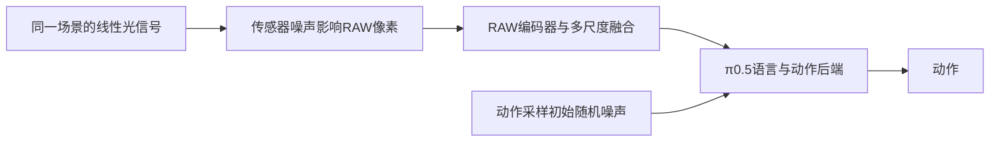

# 当前RAW闭环失败的归因

2026-10-17。对象为r8表征/融合及D1后端适配后的grab_roller正常光开发闭环。本次只重算已有日志、读取既有权重中的开发预测记录与缓存元数据；优化更新0、模型推理0、新闭环0。原始失败、权重选择和评分均不改写。C1与D1的前端可训练范围及执行约束不同，且都使用seed0；四次未通过不能当作四个独立初态的噪声重复实验。

现有证据首先支持“任务相关表征及其与π0.5的动作适配尚未学好”，还发现开发选型指标存在覆盖偏差。后端预算确实很浅，但“按原配置继续增加步数就会解决”没有得到支持。RAW抗传感器噪声不足仍可能参与失败，目前没有把它隔离出来的实验，不能判定它是主因，也不能宣称已经排除。

## 两类噪声必须分开

旧r7探针固定整份RAW、状态和指令，复用同一份视觉token，只改变动作flow采样种子。首条关节目标差异最高约90.6°，原始π0.5同项最高约1.48°。r8融合完成、后端适配尚未开始的B2源权重，同类探针首条目标变化为0.399–0.549rad，整段关节目标变化RMS为0.194–0.214rad。它们证明固定视觉条件下，动作采样可以产生显著变化；不是传感器噪声扰动实验。

固定RAW像素也不等于输入没有传感器噪声：原图中既有的噪声仍可能影响表征。这个探针不能单独把责任定位为后端，也没有测过D1所选第50/25步权重的多采样种子敏感性。B2探针的数值不能直接贴到D1模型上。来源见[r7诊断](P2_raw_visual_gap_20261016.md)及[B2原始探针](representation_r8_20261016/receipts/selected-frontend-probe.json)。

## 后端适配预算浅，且现有指标没有持续改善

D1原始π0.5的约32.02亿参数保持冻结，仅训练154.8万或619.3万低秩参数；两组都从B2融合权重重新出发，不是续接C1的100次后端更新。此前r5/r7的1000/100步主要训练替换前端，不能累计为这份新RAW表示已完成同等步数的后端适配。

每组D1实际100次更新、batch4、累积1、没有跳过全padding样本，共400个不同anchor；训练分区为3668个anchor，约0.109轮。真正用于闭环的小容量第50步只完成200个anchor，大容量第25步为100个。按逐步日志复算，两份被选适配器都只新增接触3个正常光、当前帧索引小于10的窗口。这个计数不包含原始π0.5预训练及先前融合读出的历史，也不把重叠历史帧当成独立演示。

| 原有四窗口等权MSE，越低越好 | 适配前 | 用于闭环的保存权重 | 第100步 |
| --- | ---: | ---: | ---: |
| 小容量q/v rank8 | 0.84901 | 0.82070，第50步 | 1.12379 |
| 大容量q/k/v/o rank16 | 0.84865 | 0.82779，第25步 | 1.26241 |

这是14维归一化动作的完整采样误差，不是成功率或物理角度。更大容量在当前100步、同一学习率方案下没有胜出；不能据此否定其他适配范围、学习率或充分训练，也不能把更久训练当成已验证方案。

训练目标与实际生成还存在明显分离：大容量组固定开发输入、固定噪声/时间的32维单次flow速度误差从0.56227降至0.48579，完整采样动作误差却从0.84865升至1.26241。32维里有18个动作填充维；完整采样指标只统计14维控制量。现有证据没有按维度归因其梯度，不能断言改善全部来自填充维；可以确定的是单次速度预测的改善没有同步转化为更好的动作生成。

## 开发集平均分掩盖了开场窗口退化

本次从实际被选检查点的 `dev_reference` 读取逐窗口误差，结合缓存 `metadata_json` 重建有效动作掩码。四个重建掩码的hash与冻结anchor收据全部一致。

| 开发窗口 | 光照 | 有效未来动作数/50 | 原指标权重 |
| --- | --- | ---: | ---: |
| episode16，t=1 | Over | 50 | 25% |
| episode16，t=95 | Over | 1 | 25% |
| episode17，t=92 | Normal | 3 | 25% |
| episode47，t=0 | Over | 50 | 25% |

原评测正确排除了padding，没有把补零当成低误差；问题在于对窗口等权平均。两个尾部窗口合计只有4个有效未来动作，却占总分一半；两个开场窗口合计100个有效动作，也只占一半。唯一正常光窗口已在尾部，开发选型没有检查正常光的初始50步动作，更没有覆盖五档光照。

两份实际用于闭环的权重，两个开场窗口的平均MSE均比各自适配前更差：小容量0.77382→0.86437，大容量0.77349→0.80645。相反，另外两个尾部窗口分别从0.92419→0.77702、0.92382→0.84913。于是原有总分小幅下降，但开场动作没有变好。

这不是只由不同episode或不同照明形成的分组差异：同为Over的episode16，t=1窗口在两份选中权重中均退化，t=95窗口均改善。只有这一个同episode对照，不能推广成所有轨迹阶段的规律。

作为归因复算，将同样四个窗口按有效动作步数汇总，小容量从0.78174变为0.86369，大容量从0.78141变为0.81048，两者均变差。该重算并未替换当时的选型规则或补选权重；它说明“0.82优于0.85”高度依赖窗口权重，不能作为整体动作改善的可靠证据。这些窗口也不能代表整个开发分区。

因此，闭环失败不仅仅对应“末步权重退化”：当时已经选择了较早的保存权重，仍未成功。开发验证的照明、轨迹位置和有效预测长度不足，是已定位的评估缺口；它会妨碍选型和判断训练是否有效，并不独自证明策略失败的唯一原因。

## RAW抗噪性仍未验收，任务表征也不能提前判合格

最新正常光闭环确实启用了传感器噪声：shot系数为2.5e-5、read项为3.90625e-8、white level为3.5。仿真相机源码对RAW执行信号相关的高斯噪声，方差为 `shot * raw + read`。所以“正常光失败”不能用来排除传感器噪声。亮度、饱和与噪声的影响也不能混为一项。

检查当前任务全部50份缓存的元数据：五种照明各10份，全部标记传感器噪声开启，噪声系数及white level与最新闭环相同。现有记录不支持“训练完全无噪、线上突然开启噪声”的解释；元数据一致仍不代表各区域的实际信噪比、渲染差异和噪声实现版本已被逐像素校验。当前模型接口的 `noise_model=False` 表示没有把噪声模型声明给N02，并不表示仿真没有加噪。

r8编码器从随机权重重新学习的400步使用RAW裁剪位置一致性、方差/去冗余约束及归一化RAW块预测，没有动作监督。两个裁剪来自同一份已缓存的含噪RAW，只增加裁剪、翻转和约±0.25EV增益，没有从同一干净信号独立重采样两份传感器噪声。RAW块预测的目标也包含原图既有噪声。因此，82.5%的位置匹配率不能被当成独立噪声下的稳定性，或理解目标物体和抓取关系的证据。

该编码器在后续融合和后端动作训练中一直冻结。恢复图像内容之后，尚没有验证它是否提取了足以支持抓取的任务信息。阶段冻结保护了已有表征，也限制了动作监督修正编码器；这是“RAW任务表征不足”的独立候选原因，不等同于“RAW对传感器噪声不鲁棒”。

逐尺度空间去均值及幅度归一化还存在待测风险：低信噪比区域的空间扰动可能被当作局部结构放大；同源含噪块重建可能鼓励保留噪声。但当前没有噪声开关/强度实验，不能凭这两条机制猜测就认定它们造成了失败。原始π0.5同场景成功证明任务可解、原视觉接口能工作；RGB/RAW前端与预处理不同，不能把它充当只改变传感器噪声的对照。

旧r5五光照均失败，正常光本来就失败，无法量化弱光新增的下降；这些还是旧权重、旧公共提示版本，不能用于宣称r8已通过或未通过抗噪评测。r8四次开发闭环全部使用一个正常光初态，没有执行无噪与有噪的配对比较。

## 优先区分原因的检查

先在实际D1保存权重上固定场景、状态、语言及flow噪声，从同一份干净HDR信号生成无传感器噪声、当前噪声和不同噪声种子的RAW，分别测编码特征与动作变化。再固定整份RAW及编码token，只改变flow种子，区分输入噪声的传播与动作生成的随机变化。不能把图像去噪处理当作同一干净信号的严格替代，也不能重新渲染不同物理状态后归因于噪声。

若无噪时仍无法抓取，噪声就不是该案例失败的必要条件，仍需解决任务表征/动作适配。若固定其他条件下，无噪可以持续抓持、有噪反复失败，才有直接理由把抗噪学习提到前面；单一配对也仅支持该开发案例。

扩大训练前应先补正常光开场及抓取相关窗口，分照明、时间位置和有效动作长度报告，保留当时的原始结果。使用更有代表性的完整采样与真实接触验收判断适配效果，再决定是否延长预算、调整适配范围或让编码器接受任务监督。现有证据不支持把全部预算直接加到原100步方案，也不支持直接将噪声辅助loss打开作为唯一修复。

## 证据与复算

- [既有权重及50份缓存元数据](failure_attribution_20261017/existing_evidence.json)：两份所选权重的SHA256、原开发记录、传感器噪声实现片段与源码hash。
- [汇总与掩码核对](failure_attribution_20261017/summary.json)：曝光、光照、有效动作计数、原均值和按有效步数汇总的误差。
- [远端读取脚本](failure_attribution_20261017/extract_existing_evidence.py)不执行模型前向；[本地复算脚本](failure_attribution_20261017/summarize.py)会核对冻结掩码hash与原均值。
- [r8阶段记录](P2_representation_and_fusion_r8_20261016.md)保留当时的选择标准、阶段差异及失败边界。

两份新增脚本通过 `make check`（391个Python文件格式检查、ruff及compileall）；没有改生产训练、噪声配置或评分，也没有新训练和闭环。未提交、未推送。
