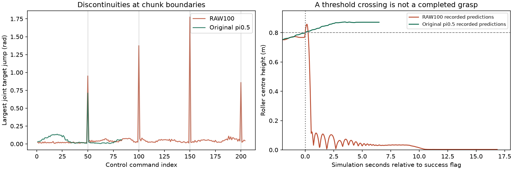

# RAW 闭环：误判与动作抖动复核

2026-10-16。用户指出视频中的动作抖动和抓取失败，复核确认两项问题均存在。**撤回此前“两次205步成功”的结论；至少一次真实RAW抓取的目标尚未达成。** 原始日志中的 `success=true` 保留为仿真原判据结果，不能作为物理完成证据。本轮没有训练更新，没有提交或推送。

## 为什么失败却显示成功

官方 `grab_roller.check_success` 只检查左右夹爪闭合和滚筒中心 `z > 0.8`。其中“闭合”来自缓存的夹爪命令 `< 0.2`，不代表夹爪实际接触物体。仿真每个物理子步检查，一次满足就锁定成功并立即结束，既不要求离桌，也不要求持续抓持。

为判断当时究竟发生了什么，在相同初态下重放原模型已经产生的动作块，继续执行到已保存预测的末尾，再保持2秒，逐物理步记录物体姿态、实际关节和接触。该回放只用于诊断，不计作新策略闭环能力；没有使用专家动作或把物体真值输入模型。原停止点之前的关节观测与原执行日志最大差为0。

| 物理证据 | RAW r7 第100步 | 原始 π0.5 参照 |
| --- | --- | --- |
| 原判据首次触发 | 控制步205，仿真87.392秒 | 控制步84，仿真33.844秒 |
| 当时滚筒中心高度 | 0.801357米 | 0.800163米 |
| 当时接触对象 | **只有桌面；没有夹爪接触** | 双手四个手指接触；无桌面接触 |
| 继续已保存预测并保持2秒 | 掉到地面，中心高度0.003037米 | 保持抓持，高度0.871083—0.871335米 |
| 连续满足新增物理条件的最长时间 | **0秒** | **5.316秒** |

RAW当时只是把滚筒顶斜，中心越过阈值，物体仍支撑在桌面上。两次205步动作逐位相同说明误判可以重现，不能证明抓取成功。此前把官方标志和执行来源审计当成完成验收，是验收错误。

官方任务源码没有被改写。判据文件SHA256为 `f0e1864199605acf59cf8982dded05129d873bb3934f200e47abafd918d41c89`，RoboTwin提交 `8e9e66544e2e9efc5910721b8d97d6dee806fa20`。新增物理判定是独立开发验收，不冒充原benchmark分数。

## 为什么动作看起来抖

模型每次预测50条绝对关节目标，执行完才重规划。相邻动作块没有衔接约束；在第50/100/150/200条边界，最大关节目标跳变分别为0.951/1.374/1.775/0.859弧度，最大约**102度**。块内最大跳变只有0.109弧度。这里统计的是目标变化，不是物理角速度；原始π0.5也有边界变化，但该次最大为0.711弧度。

另有录像时间轴问题：旧代码每条控制指令只录一帧，并以10FPS播放；一条大幅动作经TOPP插值可能持续2.76秒，却在视频中只占0.1秒。因此原视频会夸大速度突变，但无法解释或消除真实的动作块不连续。

已补录按仿真时间每0.1秒一帧的RAW诊断视频，共1043帧、104.3秒。补录运行到原停止点前关节观测最大差仍为0。监控页明确区分诊断回放与真实在线策略。新的400步在线复验视频仍沿用每条控制指令一帧，已显式标注，不能把该视频速度当成真实速度。

预览还存在一个缓存错误：旧驱动把返回观测的 `rgb` 改为 `render_rgb`，但 `get_obs` 已深拷贝到 `now_obs`，录像实际读取缓存中的 `raw_view8`，因此旧视频偏暗绿；本次补录直接使用 `render_rgb`。已修复未来驱动的缓存同步，并在页面标注既有两段视频的预览字段差异，保留原视频。三份运行光照EV/scale/noise_seed相同，原RAW回合与本次真实RAW复验的首帧三路RAW哈希全部相同，亮度差异不代表更换光照条件。

## 已做修补及真实复验

- `robotwin_grasp_acceptance.py` 增加独立验收：两手手指实际接触滚筒、无桌面接触、中心高度至少0.83米，连续1秒仿真时间；之后继续保持2秒，要求保持阶段持续有效。0.83米为演示目标0.85米减2厘米容差。接触中断或采样缺口会重置持续时间。隐藏物理量仅供评分。
- `n02_v12_robotwin.py` 增加可选执行约束：缩短重规划间隔，以及对相邻执行目标限幅。默认契约不变；此次明确使用每10步重规划、12个手臂关节目标每条指令最多变化0.05弧度，夹爪目标限制在合法范围并限制相邻变化。它是执行保护，不是新增的抓取能力。
- 监控分别保存原判据和物理验收，两个旧阳性都标为“误判·未抓起”，物理成功计数为0。没有物理复核的阳性显示待复核，不自动当成成功。原始动作、日志、视频和权重均保留。

使用同一RAW迁移臂第100步权重，固定 `grab_roller/seed0/Normal/EV +0.3196724433`，三路float32 RAW实时进入完整N02与冻结π0.5，实际40次推理、400条执行动作；没有优化更新，没有专家回放，也没有隐藏物体状态进入策略。这次执行协议有意不同于原来的50步重规划，不能混入原协议成功率。

**结果仍然失败：400步、连续有效抓持0秒、最终滚筒仍在桌面（中心高度0.758464米）。** 实际相邻关节目标最大变化0.0500001弧度，证实限幅生效；不能据此称物理运动已经全面平滑，也不能称抓取已修好。策略目前没有完成这次任务，仅靠平滑无法补上抓取能力。

权重SHA256 `aa3819af1380ba0d05f381ea4b83c3fb145a42d4a0bf9a730d64587dad9207bd`。此前辅助loss诊断和r7读出修补仍是工程事实，但此次证据没有证明辅助loss是失败的唯一原因，也没有证明RAW、N02或光照鲁棒性收益。不能用调宽判据获得成功。

## 复现与交付

checkout为 `/home/jeong/zeno/owac/worktrees/n02-measurement-completion`；远端对应 `/workspace/owac/worktrees/n02-measurement-completion`。完整原始日志与视频位于远端 `outputs/n02-v12/physics-audit-20261016/`，本地保留副本。小型物理收据在 [receipts](physics_audit_20261016/receipts/)，统计在 [physical_comparison.json](physics_audit_20261016/physical_comparison.json) 和 [action_jitter.json](physics_audit_20261016/action_jitter.json)。

可复核运行入口 [run.py](physics_audit_20261016/run.py) 和三个 `configs/runtime/n02_phys*.supervisor.conf`。回放模式 `raw/native/raw-time` 不加载新策略；`raw-live` 需要对应策略服务，使用真实权重和声明的执行约束。每次运行创建独立目录，拒绝覆盖。所有新增进程均已结束或停止，监控服务继续提供 [视频与结果](http://127.0.0.1:8081/closed-loop)。

相关运行/监控/验收测试及 `make check` 的最终结果见同目录 `physics_audit_20261016/validation.json`；CUDA条件跳过不能算GPU覆盖。真实物理复核和在线复验的收据独立于单元测试。训练保持停止，后续需要继续修策略和训练目标，直至独立物理验收与视频一致，当前不能报告RAW已成功。
