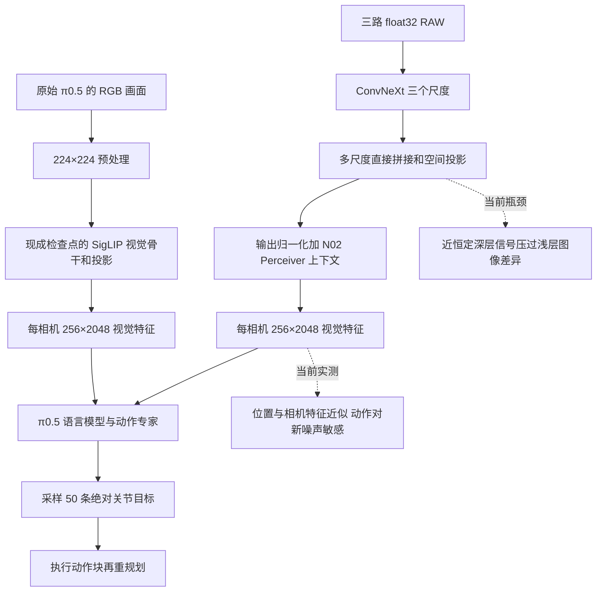
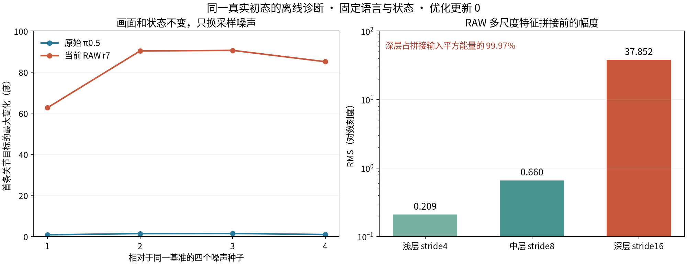

# 当前 RAW 策略与原始 π0.5 视觉路径的差距

2026-10-16。针对用户“为什么RAW动作奇怪，与原始π视觉模块差在哪里”的要求，对照实际源码、权重和同一真实初态进行离线诊断。**当前RAW迁移臂的主要异常是视觉空间信息弱、深层特征主导融合，以及动作采样对噪声过度敏感。此前增加空间支路和输出幅度归一化，没有修好这些问题。** 物理抓取仍未成功；本轮优化更新0、没有新增闭环。对照使用固定开发初态，不作为未见泛化或稳定成功率。

这里的“RAW”指当前三通道HDR-derived RAW及N02替换前端，不代表所有RAW编码器，更不是原生Bayer结论。

## 从画面到动作的实际差别

| 环节 | 原始 π0.5 | 当前 RAW r7 |
| --- | --- | --- |
| 视觉网络 | 已保存权重的SigLIP，27层、1152维，约4.124亿参数；另有约236万参数的1152→2048投影 | ConvNeXt V2-Base架构的stride4/8/16输出、N02候选/校正、Perceiver与空间支路；完整前端约1.095亿参数 |
| 输入与位置 | 实际预处理后每相机3×224×224，14×14 patch得到16×16特征格 | 原尺度240×320 RAW，采样三个尺度为每相机16×16局部格；位置、尺度与通道意义均需重新适配 |
| 权重起点 | 原始π0.5检查点的视觉和后端权重 | 当前迁移臂继承失败的r5 RAW900非读出权重；读出重新初始化，仅新训练100次更新 |
| 与后端的关系 | 现成视觉与语言/动作路径已经能完成该初态任务 | 视觉骨干和原投影均被替换，语言模型与动作专家全部冻结；训练入口甚至拒绝`freeze_backend=false` |
| 相同之处 | 每相机256个2048维token，三相机顺序，状态/语言，MEAN_STD，50步动作块和10步采样 | 接口尺寸和公共动作协议一致；不意味着特征语义、位置编码和后端适配一致 |

原始视觉特征通过当前桥接层，曾与原始路径取得前缀、flow前向和采样最大差0，同初态闭环84步动作也逐位一致。此次重新核实两条离线路径的输入文件、语言token/mask、归一化状态和采样种子哈希全部一致。因此，本次受控差异定位在视觉条件，而不是通过改变语言、关节维序或逆归一化制造差异。之前14→32维提示问题已修复，不足以解释当前结果。

## 差距一 多尺度融合被近恒定的深层特征主导

当前r7空间支路把三层各512维特征直接拼接，再线性投影到2048维。拼接前没有逐层幅度平衡，只有投影之后对整个输出做LayerNorm并乘4。相同真实初始画面下：

| 尺度 | 实际16×16采样后的RMS | 单独经过已训练空间投影的贡献RMS |
| --- | ---: | ---: |
| stride4 浅层 | 0.2088 | 0.1235 |
| stride8 中层 | 0.6604 | 0.4189 |
| stride16 深层 | 37.8520 | 25.0722 |

深层占拼接输入平方能量的**99.9665%**，投影没有补偿此失衡。各层贡献相加能重建原投影输出，相对误差`6.8e-8`；不是仅由输入幅度推测投影行为。

更关键的是，深层幅度大，但对画面变化反应很弱。固定状态和指令，只将真实RAW左右翻转，浅层头相机特征变化约18.6%，深层只有0.092%，最终视觉token仅变化0.174%。把三路RAW全部置零，最终token仍只变化约2.71%。这些是相对L2变化，并非任务效果分数。 分层来源比较另外排除了padding区域，结论仍一致。

这条链路中，图像差异已在编码器深层显著减弱；融合又让深层压过浅层，最终归一化把占主导的近恒定方向重新放大到近似固定幅度。**只把最终RMS调成接近原始视觉塔，并不能恢复先前被淹没的细节。**

排除padding后比较权重来源，头相机深层RMS在r5 RAW900为37.80、r7迁移100为37.90；左右翻转变化均约0.1%。说明迁移继承了旧骨干的异常，新100步没有修好。r7从头100步深层RMS也达8.11、翻转变化0.193%，因此问题不能仅归于迁移，更不能认为从头100步已经建立了成熟表征。三份权重均严格加载同构编码器；来源记录在[encoder-lineage-a1.json](visual_gap_20261016/receipts/encoder-lineage-a1.json)。

## 差距二 特征幅度相近 但空间信息的作用很不同

同一真实初态下，原始视觉token RMS为4.329，RAW为4.135，已不同于旧版本token RMS约40的情况。可是：

| 相同观测的检查 | 原始π0.5视觉 | 当前RAW r7 |
| --- | ---: | ---: |
| 相机内位置变化占token平方能量的比例 | 3.389% | 0.0882% |
| 空间变化的有效秩 | 19.12 | 1.48 |
| 各相机内抽样位置间平均余弦 | 0.942 / 0.980 / 0.980 | 0.99906 / 0.99906 / 0.99906 |
| 抹掉每相机位置差异后的关节目标变化RMS | **0.9770 rad** | **0.00744 rad** |
| 交换头相机与左腕相机token后的关节目标变化RMS | 0.1932 rad | 0.00299 rad |

“抹掉位置差异”是把每个相机256个token替换为该相机均值，保持状态、指令、噪声不变，再完整采样50条动作。有效秩按相机内去均值后的768×2048矩阵奇异值平方分布计算。单个均值干预会产生非自然特征，不能单独作为普遍能力定理；这里同时有真实图像翻转、逐层变化、相机干预、动作噪声和失败闭环证据。

RAW不是完全断开视觉：将所有视觉token置零仍会显著改变动作。但它对当前相机/位置差异的依赖非常弱，近恒定的视觉提示也能改变冻结后端输出。这与“能反传、梯度非零、输出尺寸正确”兼容，后者均不证明表征对控制有用。

## 差距三 视觉条件没有稳定约束采样 分块执行放大了问题

固定整份初始观测、状态、语言和权重，先提取一次视觉特征；仅改变动作flow采样的初始噪声。在与实际重规划规则相同的四个种子偏移`+50/+100/+150/+200`下，相对同一基准：

| 量 | 原始π0.5 | 当前RAW r7 |
| --- | ---: | ---: |
| 首条关节目标最大变化范围 | 0.0146—0.0259 rad，约0.84—1.48° | **1.094—1.581 rad，约62.7—90.6°** |
| 全动作块关节目标变化RMS范围 | 0.0451—0.0819 rad | 0.5246—0.8267 rad |
| 基准首条关节目标相对当前关节状态的最大偏离 | 0.1506 rad | **2.0015 rad** |

本次对照关闭TF32、显式固定采样噪声。原始π0.5基准动作块与历史日志逐位相同；RAW基准与历史生产运行最大差0.00875rad，不能冒称r7动作逐位重现。所有视觉和噪声干预在各自同一诊断精度下比较。

这直接证明：即使画面完全不变，RAW当前条件下的新噪声也足以产生大幅不同的动作起点。它没有精确量化原轨迹每次跳变中噪声、物体运动和状态变化分别占多少；也不意味着所有多模态采样都应消除。

实际控制每50步重新采样并直接切换到新动作块，于是这种敏感性表现为块间大跳变。此前真实轨迹边界最大跳变1.775rad（约102°），块内最大0.109rad，符合这个机制。原始π0.5使用同样的分块和换种子规则仍能抓取，说明不能把整个问题归为动作块接口本身。限幅可以约束执行目标，先前限幅复验仍400步失败，说明它没有补上视觉条件下的抓取能力。

## 为什么这次训练尚不足以替代原视觉模块

原始视觉特征的2048个通道，是现成π0.5后端已经能使用的表示。RAW替换连同原投影一起移除，只保留同一张量尺寸；新的特征既要表达图像，也要在冻结后端可解释的坐标和通道中表达它。固定RMS只约束整体幅度，不完成这种适配。

当前权重实际对应的训练曝光量已按逐步日志复算：r5 RAW900消费1800个不同anchor，其中grab_roller仅64个；r7迁移100的读出只消费200个anchor，覆盖36个缓存episode（可能共享原始物理演示，不能当成36条独立演示），其中当前帧为0的只有1个。r7从头臂同样只有200个anchor。训练确实打乱anchor块，并非意外只顺序训练第一个episode；但这仍是一轮短开发预算，不能等同原视觉模型的表征和策略适配训练。计数是窗口anchor曝光，不是把历史帧折算成独立演示。

训练目标和监控也不能弥补这层证据缺口：flow速度MSE包含32维中的18维动作填充，而且训练时加噪动作本身含有真实动作成分。该loss下降可以与视觉信息弱并存；它不是50步完整采样或抓取成功的保证。r7当前两个辅助项已关闭，仍有上述现象，故不能把“正在叠加的辅助loss”当作当前失败的完整解释。哪个目标、优化阶段或初始化最先导致旧骨干异常，仍需训练因果消融，不能由这次零更新探针确定。

正常光RAW输入也做了数量级复核：按文件名预先选前三个Normal缓存episode，头相机首帧均值0.177—0.223，在线为0.234，均为240×320×3 float32、同一raw_white_level协议。没有发现 `/255` 或百倍单位错误；这三例统计不排除更细的场景/时间/数据分布偏移。

## 已确定的修复优先级

首先处理**编码器深层图像差异弱与多尺度融合失衡**。应让浅层几何信息有可靠通路，验证逐尺度平衡和读出后的图像敏感性；不能只继续调最终RMS、盲目续训当前迁移权重或仅依赖执行限幅。

随后建立**新视觉表征与冻结后端的动作适配**，在相同观测、多噪声下检查首条动作和动作块稳定性，并以完整采样误差与独立物理闭环验收。若冻结后端下仍不能学会，应将允许后端适配作为单独、明确的训练方案；当前入口硬拒绝解冻，属于能力范围限制，不应被当成已经验证的最佳配置。主链保持RAW，不使用RGB教师。

历史辅助目标可能影响学习，应在基础动作路径可用后逐项加入，按共享层梯度、视觉敏感性和物理成败验证。不能由本次诊断宣称RAW本身无效、某个loss是唯一根因、逐层归一化后一定成功或已有光照鲁棒性。

## 可复查证据

- 主探针[probe.py](visual_gap_20261016/probe.py)：实际原始模型和当前RAW模型，同一观测、18次完整离线采样、0更新；[native收据](visual_gap_20261016/receipts/native.json)、[RAW收据](visual_gap_20261016/receipts/raw-warm.json)。
- [逐层图像干预](visual_gap_20261016/receipts/layers.json)、[线性贡献分解](visual_gap_20261016/receipts/level_contributions.json)、[编码器来源比较](visual_gap_20261016/receipts/encoder-lineage-a1.json)、[输入量级](visual_gap_20261016/receipts/data_probe.json)、[实际训练曝光](visual_gap_20261016/receipts/training_exposure.json)。
- 完整token、预测、加载和运行日志保存在远端及本地 ignored `outputs/n02-v12/visual-gap-20261016/`。数据与模型未写回；小型收据和源码hash受项目管理。测试和复算结果见[verification.json](visual_gap_20261016/verification.json)。

本地checkout `/home/jeong/zeno/owac/worktrees/n02-measurement-completion`，远端对应 `/workspace/owac/worktrees/n02-measurement-completion`。分支`lzh/n02-measurement-completion`，HEAD `861c46f67fff552c81fff89c5116c63b815224c5`，保留既有未提交修改。本轮仅增加诊断脚本、配置与记录，没有修改生产视觉/动作算法或重启训练；诊断服务均已退出，双GPU恢复各2MiB、0%利用，监控保留。未提交、未推送。
