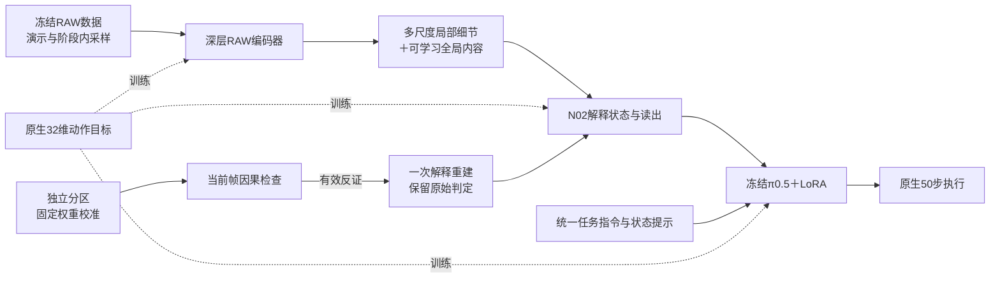

# N02 P2 r11 修复与零更新验收

本轮已修补 r10 复核发现的采样、任务指令、训练目标、融合、校准恢复和执行协议缺口，并完成真实数据、完整模型与原生策略对照验收。**优化更新为0，新 RAW 策略没有训练或闭环成功证据。** 原生 RGB 参照的成功不能计入 RAW 成功数，P3/P4 未启动，未提交推送。

最重要的新增发现是公共执行协议确实会使原生 π0.5 失败。新版恢复原生50步执行，而非继续用训练预算补偿此前加入的10步重规划和限幅组合。以下结果仅覆盖 grab_roller、Normal、seed 0；输入仍为作者 HDR-derived RAW3，不是原生 Bayer。

## 已实施的修复

| 问题 | 实际修改 | 验收与边界 |
|---|---|---|
| 变长演示开场被永久丢弃、跨阶段错标 | `BalancedBlocks` 按演示、阶段及光照边界切块，保留短块；旧算法明确保存为 `LegacyBalancedBlocks` | 冻结训练表3630个有效点全部可达；旧算法漏231个。38段演示的t0全部可达；旧算法漏33段。可达不等于已经训练曝光 |
| 训练与闭环使用不同任务文字 | 离线、在线共用规范任务指令解析；本任务固定完整指令，未知任务或缺少任务身份直接报错 | 实际服务日志确认输入为 `Grab the light brown cylindrical roller on the table.`；不再静默使用另一条提示 |
| 固定去均值、等尺度能量抹掉全局内容 | 保留局部对比支路，新增图像通道均值支路及可学习尺度权重、全局/局部增益 | 常量空间特征的内容变化能够影响输出；完整模型中新增参数获得有限、非零动作梯度。新参数尚未训练，不代表语义已对齐 |
| 编码器变化而状态模块冻结 | 任务臂开放最后6个深层块、所有尺度投影、融合读出、测量解码器及候选/修正/预测状态模块；原始后端冻结，训练声明的LoRA | 真实B8反传确认预定模块接通，原始后端无梯度；解码器及状态模块梯度很小，尚不能据接通宣称它们已有效适配 |
| 另18维仍参与去噪却不受监督 | 恢复原生32维、按有效时间掩码的flow目标；执行及控制误差仍只看14维 | 单测确认后18维有监督梯度；完整前后向有限。未增加抗噪loss；三个原辅助项均为0 |
| 校准只有统计，线上不可恢复 | 在独立calibration分区、固定权重下拟合并安装校准；保存权重指纹、分区身份和查看规则；加载严格核对 | 实际checkpoint恢复后指纹及视觉tokens逐位一致；修改权重后旧校准被拒绝并清除；训练微批开始前失效旧校准 |
| 检查没有触发修订 | 有效 `model_inadequate` 在当前决策触发一次解释状态重建，保留测量历史及原先锁定的因果判定 | 完整模型当前帧×1000的故障注入真实触发重建，动作有限。此为故障支路验收，不是传感器噪声鲁棒性结果，也不是完整依赖图撤回能力证明 |
| 执行与离线选型不一致 | N02、原生参照和离线执行代理共用版本化执行器，RPC校验协议；最终默认原生50步、无额外限幅或夹爪裁剪 | 14维完整50步为主指标，前10步、开场、关节、夹爪及执行代理均有不退化门槛。离线代理从专家状态出发，始终明确标为代理，不能代替闭环 |
| 历史帧重复读出及诊断浪费 | 历史前缀跳过不用的读出和因果诊断，当前决策保留完整计算 | 实际8个不同历史帧：读出8→1次，解码47→41次；当前tokens和q逐位一致，两次有效检查一致。单窗口前端1.277→1.092秒，不能外推整体训练加速比例 |
| 短块导致速度被高估 | 训练记录实际处理的anchors及全部微批窗口，监控用实际吞吐而非固定batch推算 | 单测覆盖实际10样本/20秒时显示30样本/分钟，不能按配置B12显示36；旧记录保留回退显示 |

## 三个真实原生策略对照

同一原生 π0.5 权重、同一任务、Normal/seed 0，优化更新均为0。使用原先已建立的物理判据：双手实际接触、无触桌、滚筒中心至少0.83m、持续1秒，再被动保持2秒。未修改高度或接触门槛。

| 实际执行 | 额外夹爪裁剪 | 指令数 | 最长连续有效抓持 | 物理验收 |
|---|---|---:|---:|---|
| 10步重规划，关节及夹爪每条限幅0.05 | 是 | 400 | 0秒 | 失败 |
| 10步重规划，无差分限幅 | 是 | 400 | 0秒 | 失败；原仿真判据曾触发，但不计成功 |
| 恢复原生50步，无额外动作变换 | 否 | 89 | 2.984秒，包含随后保持段 | 通过 |

第三组的89步采用持续抓持验收，与历史84步的瞬时仿真标志口径不同。第二、三组还存在夹爪裁剪差别，**不能仅凭此表量化重规划频率的独立因果贡献**。可以确认的是，之前的执行组合并未保持原生策略的可用性，不应继续将其失败归因于RAW编码器。

最终r11配置恢复第三组的执行方式；无限幅路径经过逐位恒等测试。取消额外变换不等于RAW动作已经平滑，后续仍须观察实际指令、轨迹和视频。新增视频单独位于闭环页“执行规则复核 · 原生RGB参照”，不进入RAW计数。

## 真实GPU画像与最终配方验收

RTX PRO 6000 Blackwell Max-Q、完整109,470,417参数前端与真实π0.5后端，8帧历史、3相机。下表为同一缓存窗口的零更新前后向；已剔除首个B8预热24.75秒。

| 微批上限 | 前后向耗时 | 吞吐 | 峰值allocated显存 |
|---|---:|---:|---:|
| B8 | 14.035秒 | 0.570 anchors/s | 54.52 GiB |
| B12 | 20.296秒 | 0.591 anchors/s | 78.34 GiB |

B12单位样本吞吐约高3.7%，默认采用B12，保留演示/阶段尾部短块。该单次画像不包含optimizer.step、Adam状态分配、定期验证或跨演示冷缓存，不能作为持续训练速度或“完全利用GPU”的保证；正式训练应以监控实际吞吐为准。没有靠填满显存宣称加速。

最终B12/native50配方又独立构建、转移初始化、拟合校准、完整采样20个开发窗口并保存/恢复step0：

- 全部3630个有效训练点仍可达，训练、开发、校准冻结分区保持。
- 20个窗口中15个有因果前缀，15个检查有效；5个首帧明确无效，不能计为通过。
- 校准来自16个独立分区窗口，权重指纹与查看规则随检查点保存；这是固定窗口经验阈值，不提供任意时间或跨光照有效性保证。
- 完整50步平衡控制MSE为1.088761；前10步为1.561979。它们只是尚未训练的新融合接口的基线，**不能和旧配方不同执行/文字条件的分数直接比较收益**。
- step0没有严格改善自身基线，选择器返回无可晋级权重，`physical_success=null`。
- 从旧r9或不同执行协议静默resume会被契约拒绝；训练resume还要求原运行目录及其冻结baseline/manifest，避免训练结束后丢失选型依据。

初始化明确沿用已核对的RAW-only400步编码器和B2融合100步权重；新增全局融合参数新建，optimizer及采样游标重置。本轮不是重新从随机初始化训练整个编码器。

## 验证与复现入口

证据目录：[repair_r11_20261017/](repair_r11_20261017/)。小型原始收据已同步至其`receipts/`子目录；大checkpoint、视频与逐物理步轨迹保留远端：

`/workspace/owac/worktrees/n02-measurement-completion/outputs/n02-v12/repair-r11-20261017/`

关键可复现脚本：

- `zero_update_probe.py`：实际漏采样复算、完整B8反传、校准保存恢复。其最初fast-prefix检查选到首帧，不能证明8帧提速；该缺口由下一脚本的t10检查补齐，原收据保留。
- `online_reload_probe.py`：实际Policy恢复及四位置调用、真正8个不同历史帧的数值/调用次数对照、旧阈值清除。
- `performance_probe.py`：预热/B8/B12实测及受控故障注入，禁止optimizer更新。
- `final_acceptance.py`：最终B12/native50完整开发验证和step0恢复。
- `bounded_execution_probe.json`、`native_nolimit_probe.json`、`native_original_execution_probe.json`：三种执行条件的冻结声明；早期探针的B8/10步配置不是最终训练配置。
- 历史共用`representation_r8_20261016/rollout.py`新增显式原生参照和版本化协议分支；未重写原来的历史结果。

最终训练配置为`configs/encoders/n02_v12/raw_task_r11_robotwin.json`及`raw_task_r11_control_robotwin.json`，默认预算1000是**尚未执行的配置**。训练入口仍为`python -m owac.training.n02_v12 --config <配置> --output <新的运行目录>`，本轮没有启动该命令。任务臂学习RAW/N02及LoRA，配对对照冻结整个前端、只训练同初值LoRA。

后续能力验收仍须真实训练、留出演示与物理闭环；现有开发集缺Low/ExtremeLow/ExtremeOver，原始任务失败原因及噪声贡献也尚未被定量分解。没有把预算押在延长后端训练或增加抗噪loss上。

本地相关测试674通过、7跳过，`make check`和`git diff --check`通过；189个源码、配置、页面及探针文件本地/远端SHA一致，7个有界验收进程均exit 0。最终记录见同目录`final_verification.json`。页面、视频Range请求已分别取得HTTP200/206；本机旧隧道复核期间出现间歇超时；保留原unit备份后启用压缩、去掉显式IPQoS覆盖并重启，页面200和视频Range206复测均约1.1秒，仍保持enabled。应用内浏览器CDP检查超时，因此不宣称已完成浏览器截图验收。
