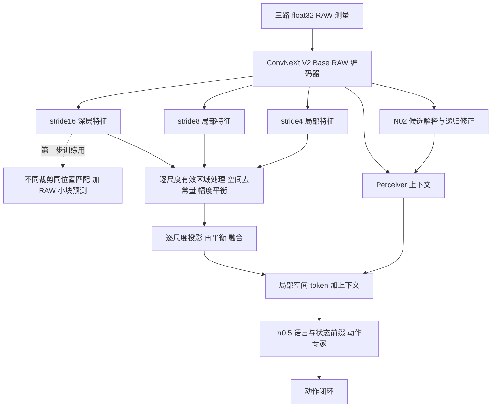

# RAW 深层表征与多尺度融合修复

按用户要求，先恢复 RAW 深层表征，再重训多尺度融合及输出通道，最后进行 π0.5 后端适配。深层表征两组各400步、两轮融合对照均已完成，图像内容重新影响动作；这还不是抓取成功。首轮后端实验两组各100步、各一次200指令闭环均未通过物理验收。进一步冻结整个前端后，两档后端适配也各完成100步，按开发指标选择第50/25步保存权重，随后各200指令闭环仍失败。本轮四次完成的开发闭环均失败，持续有效抓持均为0秒，另一次基础设施超时不计成败。真实RAW抓取目标尚未达成，当前有界训练及复验均已结束。

## 改动的原因与位置

旧读出直接拼接 stride 4、8、16 的特征。此前同观测诊断发现，stride16 的近恒定大数值占拼接能量的 99.97%，淹没了仍随图像变化的浅层信息。将输出 token 的整体幅度调到接近原始 π0.5，不能恢复图像内容，也不能让新通道自动拥有 SigLIP 的含义。旧模型的动作主要随采样噪声变化，不能靠动作限幅解决视觉条件缺失。

本次改动分三步。第一步只训练 RAW 编码器和训练用的 RAW 小块预测头，使用不同裁剪中同一传感器位置的特征一致性、方差与通道去冗余约束，再预测归一化 RAW 小块。它不使用动作标签、RGB、RGB 教师或仿真隐藏状态。第二步冻结验收后的 RAW 编码器，训练融合读出及 N02 上下文路径；π0.5 原参数保持冻结。第三步从选中的前端权重开始后端适配，当前D1轮进一步固定编码器、N02和整个读出，让后端单独学习新的通道与空间含义。

融合路径现在先分别去掉各尺度每个相机的空间常量分量，并按有效位置的空间信号幅度归一化；各尺度独立投影后再次归一化，再相加。这样，大常量、幅度和投影权重的整体增益都不能单独让某一尺度压过其他尺度。原图坐标、真实有效区域和相机顺序沿用原协议；全局外观可通过 Perceiver 上下文分支传递。

第一步不训练 π0.5，也不训练融合投影。第二步才重新学习融合通道；保持编码器冻结，防止仅用动作损失再次破坏已经恢复的图像信息。第三步使用后端LoRA适配，原始π0.5参数继续冻结。训练用 RAW 小块预测头不出现在策略推理链中。

## 深层表征实测

两组共同使用冻结 P0 划分、seed 1103、38 个训练 episode 的 456 个选定时间点及三路相机。开发池为另 5 个 episode 的 20 个时间点，路径零交集；闭环初态 episode0 继续排除。输入是 RawVLA-Bench RoboTwin 的 HDR-derived float32 RAW3，不能称为原生 Bayer CFA。

保留浅层组沿用旧 RAW 动作训练得到的浅层；全部重建组重新随机初始化完整 RAW 编码器。两组400步只表示当前表征阶段预算相同，不代表历史总训练量相同。

每组 batch32，每个样本含两个 192×256 的非同构裁剪，训练 400 步。RAW 块标签保持 FP32，卷积用 BF16。局部 VICReg 的不变性/方差/协方差均值权重为 25/25/1。协方差在两个视图间取均值，等效于官方求和写法的协方差系数 0.5；这些项基于[官方 VICReg](https://github.com/facebookresearch/vicreg)，传感器坐标匹配与 RAW 块预测是本项目适配；不是完整 VICRegL 或 masked FCMAE 复现。

| 400 步结果 | 保留浅层并重建深层 | 全部重新学习 |
| --- | ---: | ---: |
| 开发裁剪位置 top1 匹配 | 78.44% | 83.41% |
| 随机匹配率 | 0.985% | 0.985% |
| 真实 RAW 块预测 MSE | 0.2793 | 0.2189 |
| 输入空白图的同目标 MSE | 0.4284 | 0.6034 |
| 深层图像翻转相对变化 | 86.93% | 94.50% |
| 融合局部 token 翻转相对变化 | 113.32% | 109.39% |
| 平均秒每更新 | 0.8433 | 0.8144 |
| 峰值分配显存 | 46.03 GiB | 45.82 GiB |
| π0.5 后端更新 | 0 | 0 |

四项事前检查是深层翻转变化至少 5%、融合局部 token 翻转变化至少 10%、裁剪匹配至少 20%、真实输入的预测误差最多为空白输入的 90%。两组均通过。按事前规则选最终匹配率更高的全部重建组，不用闭环成功结果选编码器。选中检查点 SHA256 为 `2cd1eb6039ec9be9747f4020182286776526f2a3aad09aeeffe14d9ab8672446`。

独立扩展到开发池全部 20 个时间点后，匹配率为 82.53%，真实 RAW 块误差 0.2062、空白输入误差 0.5984，四项检查仍通过。它证明深层和融合输入重新携带可恢复的图像内容及位置对应，尚不能证明任务语义、原生 π0.5 通道语义或抓取能力。

## 融合训练与后端接线

第二步比较继承读出与全新初始化读出，二者使用同一个通过验收的 RAW 编码器、同一动作数据和原始冻结 π0.5，均不安装后端适配器。两张 Pro 6000 各完成100步；最终固定开发完整采样动作 MSE 为1.6853与2.0454，分别从2.5715与2.4289下降。这里是动作统计归一化空间的MSE，不是米、弧度或成功率。

同场景复查全新读出第50步：空间有效秩恢复到22.12，空间均值消融导致关节动作RMS改变0.2577rad（旧r7为0.00744rad），表明动作重新使用图像空间信息。但空间变化能量占token总能量97.05%，且换一个采样噪声首条关节目标仍可变化0.7283rad。这不是可以宣告完成的策略。

该诊断暴露了初版修复的限制：逐尺度空间去均值并单独固定残差幅度，使主分支失去全局内容，不能自由学习全局与局部信息的比例。因此新增显式的 `scale_balance_mode=rms`：保留每尺度的全局通道向量，只按总RMS平衡各尺度及投影结果；`contrast`保留作对照。两者共用首轮开发误差较低的继承读出100步权重、已冻结RAW编码器和冻结后端，先做零更新对照，再同预算训练。更改模式需要新训练契约，不能静默resume为原模型；这轮融合比较发生在正式后端适配之前。

在正式融合训练前，各做两次 2 步接线测试：batch4 和 batch12，分别测试原始冻结后端及 LoRA。batch4 热身后的单次更新约 3.50 秒，batch12 约 18.20 秒，因此正式阶段选 batch4。该数字是小规模画像，完整训练还包含数据读取、因果重放、验证及保存，监控显示实际运行速度。

LoRA 采用[官方 Microsoft LoRA](https://github.com/microsoft/LoRA)的 rank/alpha 缩放和零 B 初始化，局部集成使用权重参数化，覆盖后端直接访问线性层权重的路径。rank8、alpha16、q/v 共 1,548,288 个可训练参数；原 π0.5 的 3,201,953,824 个参数保持冻结。真实接线测试确认编码器和原后端逐字节不变、适配器收到梯度并影响采样动作，保存恢复后完整采样动作最大差为 0。测试权重不作为正式模型使用。

## 融合对照结果与后端接入

从同一份首轮融合权重出发，再各训练100步：空间去均值组的完整采样开发MSE为0.84875，保留全局内容的RMS组为1.67999。按事前动作验证指标选择前者，源检查点SHA256为 `b2a54b35858947f7cec746b373a58fdacafc8c5cee9dba8ace55ee284e2e55cd`。新增RMS分支在当前预算下没有胜出，不能将它记为效果改进。97%的空间变化能量是分布差异，不是单独淘汰模型的判据；全局外观也仍能通过Perceiver上下文传递。

选中前端在同一初始观测上的真实图像干预结果：置空RAW使token相对变化142.4%、关节动作RMS变化0.7313rad；左右翻转RAW使token变化62.3%、动作变化0.3560rad；只换一个采样噪声，动作RMS变化0.2144rad。这建立了图像对动作的实际影响，尚不证明动作正确。原始π0.5与RAW还使用不同空间布局：原始画面等比例缩放并补边到224×224，RAW局部格覆盖原始240×320画面；后端仍需适配新的通道与空间含义。

后端阶段从同一份选中前端出发，RAW编码器保持冻结，一臂继续冻结π0.5，另一臂只新增q/v低秩参数；原始π0.5参数均保持冻结。各100步、batch4、seed1103、同一后续数据顺序和flow RNG，使用新优化器。前端各阶段按同一前100个训练块比较；后端阶段继承源cursor100，继续后续训练块，避免重启数据顺序。原测量解码器与上下文路径仍由动作目标更新，两项旧辅助损失保持0；当前不据此主张N02生成模型、后验或绝对校准已有效。

两臂初始完整采样MSE为0.84875与0.84919，约0.05%的数值差，不能称跨臂逐位一致；同臂保存恢复的真实动作最大差为0。正式训练与闭环由 `train_then_rollout.py` 顺序执行，训练退出后才加载对应保存权重，每臂做一次正常光seed0、最多200条控制指令、1800秒时限的开发复验。它不是P4成功率实验，成败按实际物理接触与保持验收。

首轮融合100步的独立400指令复验在第360条指令触及900秒上限，最终物理评分未生成，记为基础设施超时，不能计作完整400步失败或成功。原始记录保留在 `outputs/n02-v12/representation-r8-rollouts/fusion-warm0100-a1/`。后续使用显式200指令预算、训练结束后的独占GPU和更长时限；视频保持真实仿真时间。当前仍无通过物理验收的RAW抓取。

## 后端负结果与严格固定前端

C1两组100步已完成。后端冻结对照最终开发完整采样MSE为1.03825，q/v rank8低秩适配为1.31084，均未胜过源前端的0.84875。第25步低秩组曾降到0.59782、同期对照0.97457，但该轮每50步保存，第25步没有权重，不能事后补出或拿它做闭环。每组随后200指令的真实RAW策略闭环均未通过，持续有效抓持均为0秒。早期开发误差下降没有转化为本轮已验证的抓取能力。

复查发现，C1只冻结了RAW编码器，融合读出及N02仍受动作目标更新。这并不满足“整个前端学好后保持固定，再适配后端”的严格分离。D1因此从融合阶段选中权重重新出发，设置 `policy.freeze_frontend=true`，冻结完整RAW/N02/读出/解码器，仅训练后端低秩参数；不继承已经退化的C1权重。比较q/v rank8的1,548,288个参数与q/k/v/o rank16的6,193,152个参数，均采用新优化器、相同源数据cursor100和flow RNG，各100步。

两档各2步真实接线复验已确认：整个前端以及原始后端参数hash均不变，低秩参数有梯度，屏蔽适配器后动作会变化，保存恢复后完整采样动作最大差为0。热身后单更新约2.25–2.30秒，峰值分配显存20.4–21.0GiB；这是两步画像，正式全链路约5–6秒/更新，不能用画像速度充当全程吞吐。初次D1画像因标量参数hash的字节视图错误在0更新前退出，修复展平标量后D2复验通过，失败目录保留。

D1每25步验证及保存，使用实际保存权重的完整采样开发MSE选型，不用闭环结果选权重。训练后各运行一次200指令物理验收；两臂均使用replan10、每条关节目标变化上限0.05rad的执行约束。这个执行约束与C1不同，因此不能把跨轮闭环差异全部归因于固定前端或适配容量；两档D1之间的执行约束相同。没有专家动作或隐藏物理状态进入策略输入。

| D1结果 | q/v rank8 | q/k/v/o rank16 |
| --- | ---: | ---: |
| 真实后端优化更新 | 100 | 100 |
| 前端优化参数 | 0 | 0 |
| 开发集选中保存步数 | 50 | 25 |
| 选中完整采样动作MSE | 0.82070 | 0.82779 |
| 第100步MSE | 1.1238 | 1.2624 |
| 平均秒/更新 | 5.764 | 5.605 |
| 峰值分配显存 | 20.71 GiB | 21.30 GiB |
| 实际闭环控制指令 | 200 | 200 |
| 连续有效抓持 | 0秒 | 0秒 |
| 物理验收 | 未通过 | 未通过 |

真实训练报告的可训练参数清单确认：encoder、decoder、readout、proposals/corrector、masked branch、bridge projection均为0，只有声明的后端适配器更新。两组训练与闭环流水线均正常退出，结果为任务失败，不是基础设施失败。权重选择发生在闭环之前，选中权重并非第100步。两组仍未建立正确抓取语义，扩大低秩容量在本预算下没有改善结果。

因此本轮能接受的是“深层携带图像信息、各尺度不再由大常量压制、图像干预会改变动作、阶段冻结及恢复正确”。不能接受的是“已经学出原始SigLIP语义”“空间布局已与原始π0.5等价”“后端已学会抓取”。RAW块预测和裁剪对应主要检查图像内容与位置，不能代替任务语义学习；当前负结果也不能单独区分预算、适配范围、训练目标或任务相关信息不足。两项旧辅助损失全程为0，当前失败仍存在，因此不能把本轮问题直接归于开启辅助loss。

## 验收与复现

本地工程检查 `make check` 通过（389文件格式检查、ruff及compileall）；本轮明确列出的 N02 v1.2、桥接和监控测试为653 passed、7 skipped、1个既有警告；包含数据游标、完整采样指标和物理评分边界验证。CUDA、真实 π0.5 梯度和动作保存恢复以远端接线收据为准。跳过项为本地缺少CUDA及一个numba依赖，不计为已验证。另补视频HTTP分段读取、拖动及HEAD/越界范围验证，监控专项12 passed；视频改为点击后加载。四段新视频使用codec-copy做MP4 faststart容器重排，逐帧MD5及时间戳一致，原二进制保留为各回合 `episode0.original.mp4`，收据见 `receipts/video_remux.json`。监控连接异常时已重建本地专用隧道，未改变公网暴露范围；远端API正常，本地API已取回真实0/4结果，内置浏览器预览仍观察到间歇超时，不能声称预览问题完全消失。最终检查原日志保留在 `outputs/n02-v12/representation-r8-source/{pytest-final,make-check-final}.log`。

本次采用当前 dirty worktree，Git HEAD 为 `861c46f67fff552c81fff89c5116c63b815224c5`，分支 `lzh/n02-measurement-completion`。未提交、未推送。C阶段源码快照见 `representation_r8_20261016/source_snapshot.json`，D阶段完整源码、相关配置和测试共266个文件的hash与dirty差异见 `source_snapshot_D.json`，D阶段归档时本地与远端266/266一致；视频分段读取等后续交付改动另记 `delivery_monitor_snapshot.json`，不改变策略或训练算法；快照按各自采集阶段标注，不冒称A阶段启动时已有hash快照。D执行时trainer与最终格式化版本仅有一处docstring换行差异，原hash及副本位置另记在D清单中。配置、事前计划、选择收据、开发结果、优化日志及引用来源锁位于 [representation_r8_20261016](representation_r8_20261016/)。大权重保留在远端 `outputs/n02-v12/P2/`；正式表征命令由 [supervisor 配置](../../../configs/runtime/n02_r8_representation.supervisor.conf)记录，融合命令见 [融合配置](../../../configs/runtime/n02_r8_fusion.supervisor.conf)，固定整个前端的后端适配见 [D1配置](../../../configs/runtime/n02_r8_fixedfront.supervisor.conf)。

物理闭环继续独立检查双手实际接触、离桌、高度至少 0.83m、连续保持 1 秒，再被动保持 2 秒；仿真原始瞬时 success 不替代这一验收。视频按仿真时间播放，render_rgb 仅作展示。正式 P3/P4、光照鲁棒性和稳定成功率均不由当前表征检查建立。
