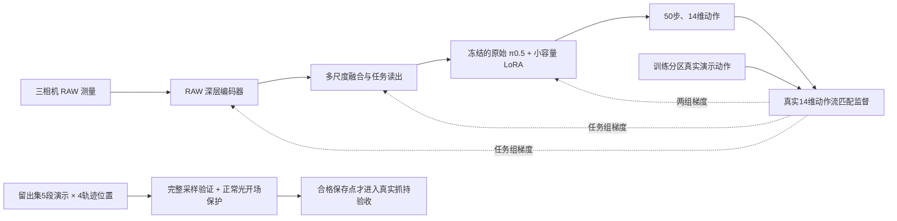
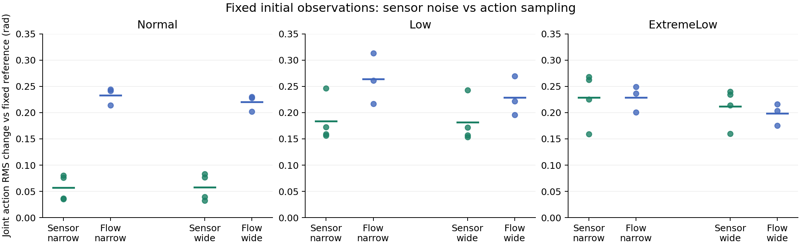
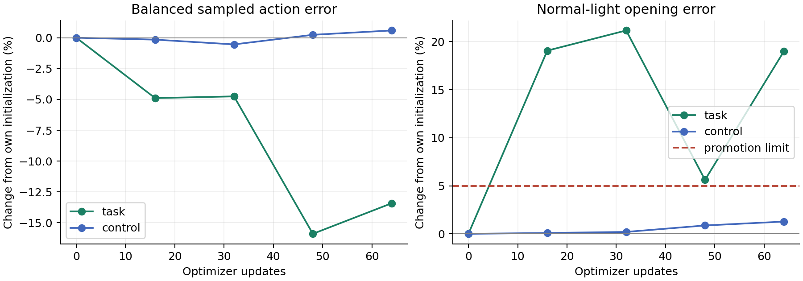

# P2：任务表征、适配训练与验证覆盖修补（r9）

本轮按用户确认的顺序执行：先让动作监督进入 RAW 深层与融合读出，修正采样和开发选型，再用小对照区分传感器噪声与动作采样随机性。只做有界 P2 修补，未进入 P3/P4，未提交或推送。RAW 输入仍是作者三通道 HDR-derived RAW，不是原生 Bayer。

## 已实施的改变



| 部分 | 此前缺口 | r9 实施 |
|---|---|---|
| 任务表征 | 400步图像自监督后，动作适配期间 RAW 编码器始终冻结 | 任务组仅解冻 stride16 最后6个块、三层投影、融合读出；动作监督真实回传 |
| 对照 | 扩大后端参数不能隔离表征问题 | 同一起点、同样 q/v rank8 LoRA、采样、学习率和预算；对照冻结整个前端 |
| 动作目标 | 原训练误差含18个补零动作维度 | 两组共同改为有效未来动作上的真实14维流匹配；输入/后端仍保持原32维接口 |
| 训练覆盖 | 旧所选权重该阶段只见3个正常光前10帧样本 | 按光照×轨迹位置均衡抽连续块，保留确定性顺序与原始曝光日志 |
| 开发覆盖 | 四窗口没有正常光开场；50/1/3/50个有效未来动作却按窗口等权 | 冻结开发集全部5段演示，每段开场、t10、中点、剩10个动作的末段，共20窗口 |
| 选型 | 平均值可被尾部改善掩盖 | 光照×轨迹阶段分别按有效动作累计误差，再对分层等权；正常光开场误差最多比本组初始值增加5%，且整体必须改善 |
| 效果报告 | 32维速度预测不等于实际动作 | 完整10次去噪采样50步14维动作，另报前10步、关节、夹爪、各分层及全体有效动作加权误差 |
| 计算 | 中间保存点重复做相同验证 | 中间验证与保存共用同一份结果；两卡各一组，microbatch由4提高至8 |

轨迹“开场/接近/后段”仅按时间位置分层，不冒称真实接触或抓取阶段标签。夹爪单独报告，但没有虚构接触监督。未添加抗噪 loss、RGB 教师或新 RAW 重建项；原因果辅助项仍关闭。原始 π0.5 参数保持冻结。

## 数据与有界预算

原 P0 train/dev/calibration 分区不变，`grab_roller/episode_000000` 继续排除在训练之外。任务训练池3668 anchors、38份演示；开发池469 anchors、5份演示。开发集这项任务实际只有 Normal/Over，Low/ExtremeLow/ExtremeOver 明确列为缺失，未从训练或校准分区借数据冒充独立验证。

预先固定[验收计划](task_r9_20261017/acceptance_plan.json)：每组64 updates，batch8，最多512次样本曝光，warmup16；每16步验证并保存。编码器学习率2e-6、读出1e-5、LoRA1e-5，各组独立梯度裁剪。初始权重均来自 r8 B2 contrast100 和通过图像检查的 fresh encoder400，LoRA重新初始化为零增量；**不继承 D1 的优化步数或适配权重**。三步试跑权重也不流入正式对照。

20个验证窗口的完整采样分数只在本次协议内比较，不能和此前4窗口数值直接比较。若全部保存点未通过开场与整段双门槛，本轮不晋级闭环；不因某个尾段变好就宣传整体学会。合格时每组最多一次 Normal/seed0、400指令闭环，沿用每10步重规划/0.05rad动作衔接约束，以及双手实际接触、离桌、高度、持续1秒抓持并继续保持2秒的物理验收。

## 真实接线验证

两组各进行3次真实优化更新，batch8。任务组编码器、读出、LoRA均有非零动作梯度；冻结组只有LoRA有梯度。冻结参数的更新前后哈希一致，真实动作保存/恢复最大差均为0。任务组峰值53.17GiB，对照34.09GiB；三步试跑包含冷启动，不能当稳定吞吐。真实训练将继续记录平均/p50/p95时延、峰值显存和实际样本覆盖。双卡一分钟20次采样的平均GPU利用率为65.85%/69.90%，平均功率约257/252W；这不是100%利用，当前先保持受控配方一致。均衡调度实际508次样本曝光（含一个4样本末块，低于512上限）、508个不同anchors、33份演示，其中正常光前10帧19次；两组64步原始日志均已逐项核验匹配。

## 传感器噪声小对照：已完成

在 Normal、Low、ExtremeLow 各采一个 seed0 初态。读取**同一相机现成的 HdrColor 缓冲区**，按原始 RAW 转换与饱和规则得到加噪前测量；使用原噪声种子重建，9路相机结果与在线 RAW **逐位一致，最大差0**。没有把已有噪声图“去噪”后冒称干净真值，没有额外重新渲染来混入物理或渲染差异。

每个初态保留无噪、原在线噪声和3份独立重采噪声。固定语言、本体状态和flow seed188390828；另在无噪固定图像上换3个flow seed。使用此前 D1 所选 narrow50/wide25 **原权重**，共54条动作块预测，优化更新0。每个采集进程只发一条保持当前位置的命令来结束官方评测器，明确标记 diagnostic_only，**不计策略闭环成败**。

下表为相对无噪/固定flow参考，12个关节、50步动作目标的 RMS 差，单位rad。传感器列范围覆盖原在线噪声及3个重采样；动作采样列范围覆盖另3个flow seed。它们是输出敏感度，不是相对专家的动作误差。

| 所选权重 | 光照 | 换传感器噪声 | 换动作采样种子 |
|---|---|---:|---:|
| narrow50 | Normal | 0.035–0.080 | 0.214–0.244 |
| narrow50 | Low | 0.156–0.246 | 0.217–0.313 |
| narrow50 | ExtremeLow | 0.159–0.268 | 0.200–0.249 |
| wide25 | Normal | 0.033–0.083 | 0.202–0.230 |
| wide25 | Low | 0.154–0.243 | 0.195–0.269 |
| wide25 | ExtremeLow | 0.160–0.240 | 0.175–0.216 |

两档权重共用冻结前端，传感器噪声引起的视觉token相对L2变化分别为：Normal约8.1%、Low约35%、ExtremeLow约66%。正常光噪声对输出的影响小于本次flow种子变化，但并不为零；暗光噪声造成了与flow种子变化相近的动作扰动，已成为可复现的风险。**不能从这3个初态推断闭环失败的主因，也未测全轨迹或噪声开关下的闭环成功率。** 此证据支持先恢复任务能力，同时保留后续针对暗光噪声处理的必要性；不支持现在把全部预算交给更长后端训练或直接叠抗噪 loss。



图中每个点对应一份真实动作块，横线为这些点的均值；不绘制成功率或置信区间。

原始收据：[narrow](task_r9_20261017/receipts/noise/d1-narrow-a1/noise_probe.json)、[wide](task_r9_20261017/receipts/noise/d1-wide-a1/noise_probe.json)；采集与重建收据位于同目录 `receipts/captures/`。完整浮点测量与动作数组保留远端 ignored outputs。

## 新权重的追加零更新噪声复核

为了避免把旧 D1 表征的噪声表现直接沿用到 r9，空闲卡又对任务组48步（整体最佳但**未通过开场门槛**）和对照所选32步，复用了完全相同的三份加噪前测量、原在线噪声、三份重采噪声和固定flow种子，另27×2条动作块，优化更新0。它们不是新的策略闭环，也没有改变选型结果。

| 新权重 | Normal传感器扰动 | Low传感器扰动 | ExtremeLow传感器扰动 |
|---|---:|---:|---:|
| 对照32步 | 0.033–0.075 rad | 0.155–0.245 rad | 0.157–0.218 rad |
| 任务组48步，未晋级 | 0.053–0.100 rad | 0.160–0.266 rad | 0.169–0.539 rad |

均为相对固定无噪参考的50步关节动作 RMS 差。新前端的token噪声敏感度仍约8%/35%/66%，本次任务适配并未消除暗光风险；任务组某份极低光噪声重采样引发了更大的动作扰动。两份新权重的训练范围、步数不同，不能把二者差异归因给某一个模块。噪声探针累计108条动作块，仍只有每种光照一个物理初态，**不能换算成成功率、全轨迹鲁棒性或失败原因占比**。原始[任务48步](task_r9_20261017/receipts/noise/r9-task-48-a1/noise_probe.json)、[对照32步](task_r9_20261017/receipts/noise/r9-control-32-a1/noise_probe.json)、[追加复算](task_r9_20261017/noise_current_summary.json)。

## 当前结论与边界

动作监督进入深层与多尺度读出的工程路径、分层取样、正常光开场验证、完整动作选型和真实抓持验收已经打通。本轮训练配方**没有通过任务能力验收**：任务组部分轨迹改善但开场退化，仅调后端的对照改善很小且闭环失败；不能继续用“整体误差下降”代替任务表征学好。

下一轮应围绕开场和实际执行的前10步动作目标做明确对照，进一步核查阶段监督和前端/后端的配合；这是本轮发现所支持的后续方向，尚未实施为新训练结论。低光/极低光还需要独立任务验证覆盖。现有证据不支持单纯继续拉长同样的后端训练，也不支持不经消融直接叠加抗噪loss。固定开发初态仍不等于正式P4，独立成功率、RAW增益和机制增益均未通过。

两组训练、闭环及噪声复核全部结束，计算资源释放；保留监控服务。未提交推送，未启动P3/P4。

## 执行与复现

两组均完成64次更新，实际各508次曝光、508个不同anchor、33份训练演示，确定性顺序与原始优化日志逐项匹配。正常光前10帧各19次；并不是完整遍历训练池。没有非有限动作loss；本预算任务/对照loss范围分别0.319–4.211 / 0.374–4.157。优化更新合计128，另有两组三步试跑合计6次，不混入正式权重。

| 权重/状态 | 分层完整动作MSE | 正常光开场MSE | 正常光开场前10步MSE | 处理 |
|---|---:|---:|---:|---|
| 任务组初始 | 0.98600 | 1.06264 | 1.92959 | 同源B2起点 |
| 任务组48步，整段最佳 | 0.82929（−15.89%） | 1.12231（+5.61%） | 2.35388（+21.99%） | 未通过开场门槛 |
| 任务组64步 | 0.85372（−13.42%） | 1.26445（+18.99%） | 2.12832（+10.30%） | 未通过开场门槛 |
| 冻结视觉对照初始 | 0.98520 | 1.05947 | 1.92509 | 同源B2起点 |
| 对照32步，选中 | 0.97985（−0.54%） | 1.06156（+0.20%） | 1.92608（+0.05%） | 晋级一次真实闭环 |
| 对照64步 | 0.99099（+0.59%） | 1.07295（+1.27%） | 1.95655（+1.63%） | 未选中 |

百分比相对各组自己的初始值，误差均为归一化动作空间MSE。两组初始值有约0.08%的整体差、约0.30%的开场差，冻结范围改变会影响GPU数值路径；没有把这种小差异当成训练收益。单种子、五段留出演示，不做显著性或稳定能力结论。

任务组四个保存点均不满足预设开场门槛，**不晋级闭环，也没有抓持成功证据**。深层与读出联合接受动作监督，确实改善了部分留出轨迹的整体动作指标；但本配方没有同时学好正常光开场。不能将其解读成“任务表征已解决”，也不能据此归因编码器单独失败。对照组只获得很小的开发改善，不能凭此宣称后端适配已完成。



任务组平均13.40秒/更新、p95为15.08秒，峰值53.46GiB；对照11.19秒/更新、p95为13.43秒，峰值34.30GiB。按实际508次曝光和纯更新耗时折算约35.5 / 42.6样本每分钟。这些时延不包含验证、保存、加载与闭环，总墙钟另见pipeline收据。中间保存点复用了周期验证；最后一步额外独立复测一次。

对照32步已完成400指令真实闭环，运行正常退出；**物理验收失败，最长有效抓持0秒**，原瞬时成功判据也未触发。结束保持阶段滚筒仍触桌，z约0.7415m，未抬离初始高度。任务组未晋级，不记为闭环失败或成功；本轮新增有效策略闭环为0/1。当前没有得到真实RAW抓取成功。[物理收据](task_r9_20261017/receipts/closed-loop-control/summary.json)。原始[任务组选择](task_r9_20261017/receipts/task/selection.json)、[对照组选择](task_r9_20261017/receipts/control/selection.json)、[曝光复核](task_r9_20261017/exposure_summary.json)、[结果复算](task_r9_20261017/results_summary.json)均保留。

```bash
cd /workspace/owac/worktrees/n02-measurement-completion
PYTHONPATH=src:/workspace/owac/rawvla/source/starVLA CUDA_VISIBLE_DEVICES=1 \
  outputs/n02-full/runtime/py310-cu128/bin/python \
  research/experiments/n02_v1_2/task_r9_20261017/run.py \
  --config configs/encoders/n02_v12/raw_task_r9_task_robotwin.json \
  --output outputs/n02-v12/P2/raw-task-r9-task-s1103-a1 \
  --case outputs/n02-v12/representation-r8-rollouts/task-r9-task-a1 --port 18521
```

该命令仅用于复现记录，现有输出非空会拒绝覆盖，不要与当前 supervisor 重复启动。对照使用 control 配置、GPU0、端口18520及独立输出。原始结果目录有完整 `optimization.jsonl`、`history.jsonl`、`task_sampler.json`、`task_dev_manifest.json`、保存点指标和 `selection.json`。

[源码快照](task_r9_20261017/source_snapshot.json)固定运行前279份源文件/配置/测试及协议，远端逐份校验279/279相同。归档位于 `outputs/n02-v12/task-r9-source-a1/source.tar.gz`（本地和远端均保留）。包含尚未提交的工作树实现；Git HEAD本身不能代表执行源码。试跑发生在新增freeze标志冲突检查之前，实际训练范围由非零梯度/冻结参数哈希核验；正式任务已使用语义一致的标志和独立源码快照。

本地 `make check` 通过；相关测试649 passed / 6 skipped（缺CUDA或可选numba），不等于策略能力通过。其后监控补充了“开场退化不得显示通过”和“展示实际闭环选中权重而非末次权重”的回归测试，监控子集14 passed。真实动作接线/更新/恢复另由服务器收据验证。

监控：[固定入口](http://127.0.0.1:8081/)；显示当前两组的状态、速度、完整动作验证和正常光开场误差。保留旧失败视频和误判记录，训练完成不自动显示为抓取成功。
